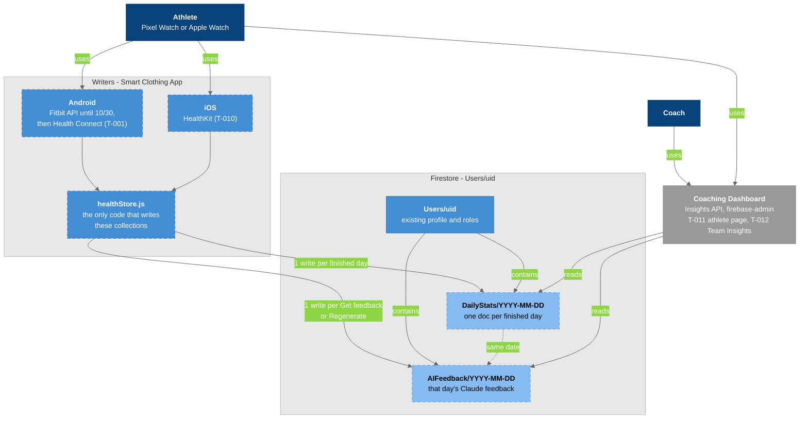
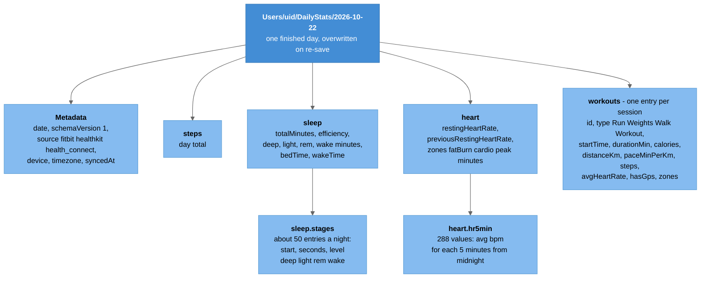
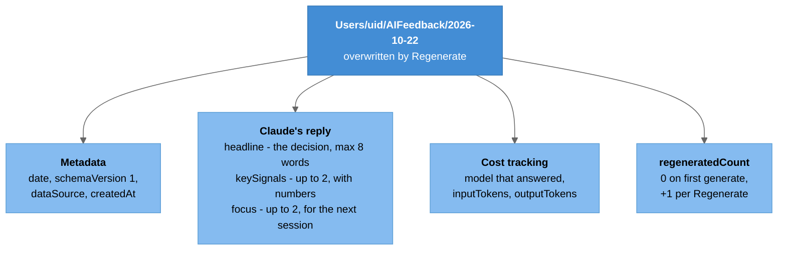
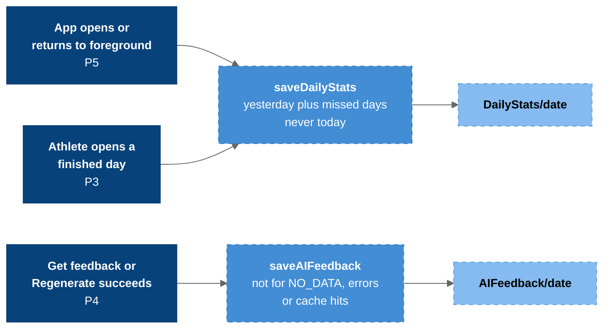

# Firestore Health Schema (DailyStats + AIFeedback)

*Created 2026-10-21. This is the schema [[T-009_Save_Daily_Stats_To_Firestore]] builds, phase by phase. It's the contract the Smart Clothing App writes (Android and iOS) and the Coaching Dashboard reads, until the Boracle platform replaces Firestore. The old-vs-new comparison is in [[Firestore_Schema_Proposal]]; the old collections are in [[Firestore_Schema]].*

**Status:** designed, not built yet. Both collections are empty until T-009 P3 ships. Real data only, never fake or seed data.

---

## Overview

```
Users/{uid}                       existing: profile, role, coachList, authorizedAthletes
 ├── DailyStats/{YYYY-MM-DD}      NEW  one doc per finished day      writer: the app
 └── AIFeedback/{YYYY-MM-DD}      NEW  that day's Claude feedback    writer: the app
```

`Users/{coachUid}/TeamFeedback/...` (the coach's team assessment) is designed and written by the senior design team in [[T-012_Team_Insights_AI_Feedback_PoC]]. It's not part of this schema.



### Legend

- **Dark blue** = people
- **Blue** = the app (**dashed** = new or changed by T-009) and the existing `Users` document
- **Light blue dashed** = the two new collections
- **Gray** = the Coaching Dashboard (separate repo), which only reads
- **Light gray boxes** = boundaries
- **Solid arrow** = uses, writes, contains or reads; **dashed arrow** = `AIFeedback` shares its date with that day's `DailyStats`

---

## One `DailyStats` document



### Legend

- **Blue** = the document
- **Light blue** = its fields (maps and arrays)
- **Arrow** = contains

A run's stats card (duration, energy burned, distance, pace, steps, average HR) reads one `workouts[]` entry. There are no day activity totals (`activity` was cut on 2026-10-21; [[T-008_Daily_Activity_Stats]] may add them later).

---

## One `AIFeedback` document



### Legend

- **Blue** = the document
- **Light blue** = groups of fields
- **Arrow** = contains

---

## When the app writes



### Legend

- **Dark blue** = what triggers a save (with the T-009 phase that adds it)
- **Blue dashed** = `healthStore.js` functions
- **Light blue dashed** = the documents
- **Arrow** = leads to

A failed write is logged and never breaks a screen. Re-saving the same day overwrites the same document (id = date), so there are never duplicates.

---

## Field reference

### `Users/{uid}/DailyStats/{YYYY-MM-DD}`

| Field | Type | Content |
|-------|------|---------|
| `date` | string | The athlete's **local** date, same as the id |
| `schemaVersion` | number | `1`; bumped on any breaking change |
| `source` | string | `"fitbit"`, `"healthkit"` or `"health_connect"` |
| `device` | string or null | Watch model, if known |
| `timezone` | string | IANA zone of the phone when saved |
| `syncedAt` | timestamp | `serverTimestamp()` |
| `steps` | number or null | Day total |
| `sleep` | map or null | `totalMinutes`, `efficiency`, `deep`, `light`, `rem`, `wake`, `bedTime`, `wakeTime`, `stages` |
| `sleep.stages` | array | `[ { start, seconds, level } ]`; `level` is `deep`, `light`, `rem`, `wake` (classic nights: `asleep`, `restless`, `awake`) |
| `heart` | map | `restingHeartRate`, `previousRestingHeartRate`, `zones { fatBurn, cardio, peak }`, `hr5min` |
| `heart.hr5min` | 288 × (number or null), or null | Average bpm per 5-minute slot from local midnight |
| `workouts` | array | `[ { id, type, startTime, durationMin, avgHeartRate, calories, steps, distanceKm, paceMinPerKm, hasGps, zones } ]` |

### `Users/{uid}/AIFeedback/{YYYY-MM-DD}`

| Field | Type | Content |
|-------|------|---------|
| `date` | string | Same as the id |
| `schemaVersion` | number | `1` |
| `headline` | string | The decision for the next session |
| `keySignals` | string[] | Up to 2 pieces of evidence, each with a number |
| `focus` | string[] | Up to 2 constraints for the next session |
| `model` | string | The model that actually answered (can differ after a fallback) |
| `inputTokens`, `outputTokens` | number | For cost: tokens × the model's price |
| `dataSource` | string | `source` of the day the feedback used |
| `regeneratedCount` | number | How many times Regenerate was tapped |
| `createdAt` | timestamp | `serverTimestamp()` |

The plain-English "what each field is for" section is in [[T-009_Save_Daily_Stats_To_Firestore]].

### Rules for every field

- Missing values are **`null`, never `0`**.
- Times are **local** ISO strings without an offset; `timezone` says which zone.
- No raw vendor payloads, no GPS routes.
- Only finished days; today is never saved.

### What is not stored

| Data | Why not |
|------|---------|
| Per-minute heart rate as documents | About 1,440 writes per athlete per day. `hr5min` keeps the day's HR line in one write |
| Sleep stage segments as documents | About 30-80 writes per night. They're in `sleep.stages` |
| Day activity totals | Cut 2026-10-21; per-workout stats are in `workouts[]` |
| GPS routes | Large and sensitive; not needed by the dashboard yet |
| Today's unfinished day | It would be overwritten by the full day |

---

## Write budget

| Per athlete per day | Writes |
|---------------------|--------|
| `DailyStats` | 1 |
| `AIFeedback` (plus the occasional Regenerate) | 1-3 |
| **Total** | **about 2-4** |

60 athletes is about 120-240 writes a day, about 1% of the 20,000-write free tier.

## Security (T-009 P6)

`DailyStats` and `AIFeedback`: read and write only by their owner (`request.auth.uid == uid`). The dashboard reads through its API with `firebase-admin`, which bypasses rules. The catch-all rule is narrowed at the same time, agreed with the dashboard team ([[Firestore_Rules]]).

## Related Notes

- [[T-009_Save_Daily_Stats_To_Firestore]]
- [[Firestore_Schema_Proposal]]
- [[Firestore_Schema]]
- [[Firestore_Rules]]
- [[T-011_Dashboard_Athlete_Health_Page]]
- [[T-012_Team_Insights_AI_Feedback_PoC]]
- [[T-010_iOS_Apple_Watch_AI_Feedback_PoC]]
- [[T-001_Android_Health_Connect]]
