# Coach Access & Permissions

How an athlete grants, reviews, and revokes a coach's access to their data: the Firestore fields involved, the two modals, and the thunks behind them.

---

## Overview

Coaches invite athletes from the Coaching Dashboard. The invitation lands as a document reference in the athlete's `Users/{uid}.pendingPermissions` array and (via a Cloud Function) as a push notification. The athlete accepts or denies in `NotificationPermissionsModal`; accepted coaches move to `coachList` and are managed later in `PermissionsModal` under Settings.

---

## Data model (`Users/{uid}`)

| Field | Type | Meaning |
|-------|------|---------|
| `pendingPermissions` | `DocumentReference[]` to `Users/{coachId}` | Invites awaiting a decision |
| `coachList` | `DocumentReference[]` | Coaches with access |
| `disabledCoachList` | array | Written as `[]` at signup; intended for paused sharing |
| `CoachListDisabled` | array | What `fetchCoachAccess` actually reads to compute `sharingEnabled` (different casing; never written by this repo) |

Redux mirrors these as resolved objects `{coachId, firstName, lastName, ref, sharingEnabled?}` in `state.user.pendingPermissions` and `state.user.coachAccess`.

---

## Flow

```mermaid
%%{init: {'theme': 'base', 'flowchart': {'useMaxWidth': true}, 'themeVariables': {'primaryColor': '#438DD5', 'primaryTextColor': '#fff', 'lineColor': '#666', 'fontSize': '14px'}}}%%
sequenceDiagram
    actor Athlete
    participant App as App.js
    participant NM as NotificationPermissionsModal
    participant PM as PermissionsModal (Settings)
    participant Actions as userActions.js
    participant FS as Firestore Users/uid

    rect rgb(40, 85, 140)
    Note over App,FS: Invite arrives (push tap or pendingPermissions non-empty on boot)
    App->>NM: coachNotificationPermissionsModalVisible(true)
    NM->>Actions: fetchPendingPermissions()
    Actions->>FS: getDoc -> resolve each pendingPermissions ref
    Actions-->>NM: state.user.pendingPermissions
    end

    rect rgb(46, 110, 70)
    Note over Athlete,FS: Allow (Deny = removeFromPendingPermissions only)
    Athlete->>NM: Allow coach
    NM->>Actions: removeFromPendingPermissions(coach, remaining)
    Actions->>FS: updateDoc pendingPermissions arrayRemove(coach.ref)
    NM->>Actions: startAddToCoachAccess(coach)
    Actions->>FS: updateDoc coachList arrayUnion(coach.ref)
    end

    rect rgb(95, 95, 95)
    Note over Athlete,FS: Later, Settings - MANAGE PERMISSIONS
    Athlete->>PM: open
    PM->>Actions: fetchPendingPermissions(), fetchCoachAccess()
    Actions->>FS: getDoc -> resolve coachList refs, mark sharingEnabled from CoachListDisabled
    Athlete->>PM: swipe row -> Delete
    PM->>Actions: deleteFromCoachAccess(coach)
    Actions->>FS: updateDoc coachList arrayRemove(coach.ref)
    end
```

### Legend

- **Blue** = the invite surfaces and pending coaches are resolved
- **Green** = the athlete allows a coach
- **Gray** = managing coaches later from Settings

---

## Modals

| Modal | Where mounted | Opens when | Actions |
|-------|---------------|-----------|---------|
| `NotificationPermissionsModal` | `App.js` (global) | `coachNotificationPermissionsModalVisible` is true: notification tap with `screen === "Home" && showPermissionsModal`, or `checkPendingPermissions` finds a non-empty list on boot / login | Lists pending coaches with Allow / Deny; props `coachId`, `coachName` highlight the coach from the tapped notification |
| `PermissionsModal` | `SettingsScreen` | MANAGE PERMISSIONS button | Pending section (Allow / Deny) + current coaches as `Swipeable` rows (`CoachAccessSwipeAction`): **Stop/Share** toggle (local state only, the Firestore write is commented out), **Delete** (`deleteFromCoachAccess`), **More** (no-op) |

---

## Thunks (`src/actions/userActions.js`)

| Thunk | Firestore op |
|-------|-------------|
| `fetchPendingPermissions()` | `getDoc(Users/{uid})`, then `getDoc` per ref; dispatches `updatePendingPermissions(resolved)` |
| `removeFromPendingPermissions(coach, remaining)` | `updateDoc({pendingPermissions: arrayRemove(coach.ref)})`; dispatches `updatePendingPermissions(remaining)` |
| `fetchCoachAccess()` | `getDoc`, resolve `coachList` refs, `sharingEnabled = !CoachListDisabled.includes(ref)`; dispatches `updateCoachAccess` |
| `startAddToCoachAccess(coach)` | `updateDoc({coachList: arrayUnion(coach.ref)})`; dispatches `addToCoachAccess` |
| `deleteFromCoachAccess(coach)` | `updateDoc({coachList: arrayRemove(coach.ref)})`; dispatches `removeFromCoachAccess` |
| `startDisableCoachAccess` | Commented out; the pause-sharing feature is not wired to Firestore |

---

## Known gaps

- Pause sharing (Stop/Share) never persists.
- `disabledCoachList` vs `CoachListDisabled` casing mismatch.
- The athlete side never verifies that the coach document has `role == "coach"`; rules allow any authenticated user to append to `pendingPermissions` ([[Firestore_Rules]]).
- The Cloud Function does not write `pendingPermissions`; the dashboard must, or the modal opens with an empty list.

---

## Key Files

| File | Purpose |
|------|---------|
| `src/components/NotificationPermissionsModal/index.jsx` | Invite response modal |
| `src/components/PermissionsModal/index.jsx` | Settings permissions manager |
| `src/components/PermissionsModal/CoachAccessSwipeAction.jsx` | Swipe row actions |
| `src/actions/userActions.js:685-863` | Thunks above |
| `src/reducers/userReducer.js` | `coachAccess`, `coachAccessDisabled`, `pendingPermissions` |
| `App.js` | `checkPendingPermissions`, `handleNotificationResponse` |

---

## Tests

| Suite | Covers |
|-------|--------|
| `__test__/__unit-test__/__reducers-test__/userReducer.unit.test.js` | `pendingPermissions` reducer cases only |
| none | No test covers the permission modals or the coach-access thunks |

See [[Testing]] for tooling and mocks.

---

## Related Notes

- [[Push_Notifications_Client]]
- [[Cloud_Functions]]
- [[Firestore_Schema]]
- [[Firestore_Rules]]
- [[Profile_Settings]]
