# Insights & Activity Rings

The `Insights` screen and the Apple-style activity rings used on the Home dashboard. Everything here is mock data.

---

## Overview

`ViewInsights` (route `Insights`, reached from the "View" button in `DailyInsights` on Home) shows a `DateToolbar`, the same 7-day `DailyInsights` strip in selectable mode, one large `ActivityRings` canvas for the selected day, three `ActivityChart` bar rows (Move / Exercise / Stand), and an **"Update Activity Rings Data"** button.

---

## Data flow

```mermaid
%%{init: {'theme': 'base', 'flowchart': {'useMaxWidth': true}, 'themeVariables': {'primaryColor': '#438DD5', 'primaryTextColor': '#fff', 'lineColor': '#666', 'fontSize': '14px'}}}%%
flowchart LR
    btn["Update Activity Rings Data<br/>button"]
    thunk["updateActivityRings()<br/>src/actions/appActions.js"]
    rand["generateRandomValue()<br/>per day, per ring<br/>1 s delay each"]
    store["state.app.activityRingsData<br/>Sunday..Saturday -> ring1, ring2, ring3"]
    strip["DailyInsights<br/>7 small ActivityRings"]
    big["ActivityRings (large)<br/>selected day"]

    btn --> thunk --> rand --> store
    store --> strip
    strip -->|"handleRingPress(day)"| big

    style btn fill:#438DD5,color:#fff,stroke:#3579B8
    style thunk fill:#438DD5,color:#fff,stroke:#3579B8
    style rand fill:#999,color:#fff,stroke:#888
    style store fill:#438DD5,color:#fff,stroke:#3579B8
    style strip fill:#438DD5,color:#fff,stroke:#3579B8
    style big fill:#438DD5,color:#fff,stroke:#3579B8
```

### Legend

- **Blue** = real app code (button, thunk, Redux slice, ring components)
- **Gray** = the random-number generator standing in for real activity data

| Element | Source | Status |
|---------|--------|--------|
| `activityRingsData` | `appReducer` initial state: every day `{ring1: 0, ring2: 0, ring3: 0}` | Zeros until the button is pressed |
| `updateActivityRings()` | Loops the 7 days, `await`s 1 s, dispatches `updateActivityRingsData(day, randomRings)` | **Random mock** |
| `ActivityChart` Move / Exercise / Stand | props `goal={800 / 30 / 12}` `progress={314 / 15 / 3}` | **Hard-coded literals** |
| `DateToolbar` | No `dataType`, so it shows today and dispatches nothing | Decorative |
| `DateTimePicker` | `showDatePicker` state is never set to true | Dead code |

---

## `ActivityRings`

`src/components/visualizations/ActivityRings/ActivityRings.jsx` draws three concentric progress rings on a `@shopify/react-native-skia` `Canvas` (`Ring.jsx`, `Frag.js`). Props: `scale`, `canvasWidth`, `canvasHeight`, `horiPos`, `vertPos`, `totalProgress {ring1, ring2, ring3}` (0-1 fractions). Colors come from `AppColor.ringMove`, `ringExercise`, `ringStand`.

`DailyInsights` renders it at `scale 0.17` in a 50x50 canvas per weekday; `ViewInsights` at `scale 0.9` in 400x220. In non-dashboard mode each small ring is wrapped in a `TouchableWithoutFeedback` that calls `handleRingPress(dayName)` and dims the unselected days.

---

## Screen States

| State | Display |
|-------|---------|
| Fresh | All rings empty, bars at `progress` literals |
| After "Update" | Rings fill with random fractions, one day per second |

There is no Firestore collection for activity rings on `main` (the Coaching Dashboard does not read one either).

---

## Key Files

| File | Purpose |
|------|---------|
| `src/screens/ViewInsights/index.jsx` | Screen layout, `handleRingPress`, update button |
| `src/components/DailyInsights/DailyInsights.jsx` | 7-day ring strip (dashboard + selectable modes) |
| `src/components/visualizations/ActivityRings/*` | Skia rings |
| `src/components/visualizations/ActivityChart/ActivityChart.jsx` | Bar rows with `goal` / `progress` |
| `src/actions/appActions.js:47-98` | `updateActivityRingsData`, `updateActivityRings` |
| `__test__/__integration-test__/__main-tab-test__/__main-screen-test__/ViewInsightsScreen.test.js` | Snapshot test |

---

## Tests

| Suite | Covers |
|-------|--------|
| `__test__/__integration-test__/__main-tab-test__/__main-screen-test__/ViewInsightsScreen.test.js` | Insights render + snapshot |
| `__test__/__unit-test__/__actions-test__/appActions.unit.test.js` | `updateActivityRings` and the other app actions |

See [[Testing]] for tooling and mocks.

---

## Related Notes

- [[Home_Dashboard]]
- [[Redux_State]]
- [[Health_Data_Screens]]
