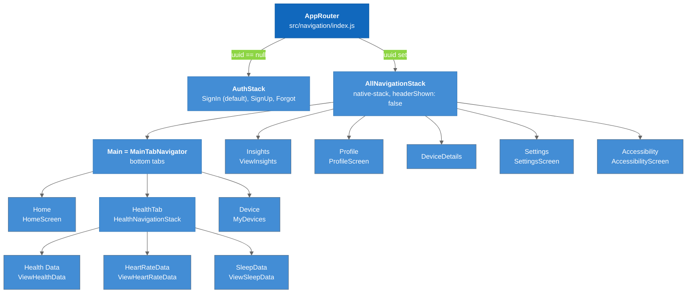

# Navigation

React Navigation 6 structure: the auth/main switch, the bottom tabs, and the top-level routes.

---

## Overview

### Legend

- **Blue (dark)** = `AppRouter`, the switch between logged-out and logged-in
- **Blue** = navigators (stacks and the tab bar)
- **Default** = individual screens

`AppRouter` imports the default export of `HomeStack.jsx`, which is `AllNavigationStack` (the import is named `MainTabNavigator` in `index.js`, which is misleading).

---

## Routes

| Navigator | Route name | Component | Reached from |
|-----------|-----------|-----------|--------------|
| AuthStack | `SignIn` | `SigninScreen` | default |
| AuthStack | `SignUp` | `SignupScreen` | SignIn link |
| AuthStack | `Forgot` | `ForgotPasswordScreen` | SignIn link |
| AllNavigationStack | `Main` | `MainTabNavigator` | default |
| MainTabNavigator | `Home` | `HomeScreen` | tab (home icon) |
| MainTabNavigator | `HealthTab` | `HealthNavigationStack` | tab (heart icon) |
| MainTabNavigator | `Device` | `MyDevices` | tab (devices icon) |
| HealthNavigationStack | `Health Data` | `ViewHealthData` | default |
| HealthNavigationStack | `HeartRateData` | `ViewHeartRateData` | `DataButton` |
| HealthNavigationStack | `SleepData` | `ViewSleepData` | `DataButton` |
| AllNavigationStack | `Insights` | `ViewInsights` | `DailyInsights` "View" button |
| AllNavigationStack | `Profile` | `ProfileScreen` | `AppHeader` menu "Edit Profile" |
| AllNavigationStack | `Settings` | `SettingsScreen` | `AppHeader` menu "Settings & Privacy" |
| AllNavigationStack | `Accessibility` | `AccessibilityScreen` | `AppHeader` menu (placeholder screen) |
| AllNavigationStack | `DeviceDetails` | `DeviceDetails` | `DeviceCard` press |

Screens pushed from a tab pass `{ previousScreenTitle: route.name }` so `AppHeader` can show a back title.

---

## Conventions

- All navigators use `headerShown: false`; `AppHeader` renders the title, back arrow, and the overflow menu (Edit Profile / Settings & Privacy / Accessibility / Logout).
- The tab bar is styled as a floating pill (`position: "absolute", bottom: 10`) and hides labels except for the focused tab.
- Screens and components are imported through the barrels `src/screens/index.js` and `src/components/index.js`.

---

## Dead code

`HomeNavigationStack`, `DevicesNavigationStack`, and `InsightsNavigationStack` in `HomeStack.jsx` are defined but never rendered; their routes are covered by `AllNavigationStack`.

---

## Key Files

| File | Purpose |
|------|---------|
| `src/navigation/index.js` | `AppRouter` auth/main switch |
| `src/navigation/AuthStack.jsx` | Auth native stack |
| `src/navigation/HomeStack.jsx` | Tabs + `AllNavigationStack` (default export) |
| `src/components/AppHeader/index.jsx` | Header + menu used by every screen |

---

## Tests

| Suite | Covers |
|-------|--------|
| `__test__/__integration-test__/__auth-stack-test__/__auth-navigation-test__/` | Auth -> main tab transitions |
| `__test__/__integration-test__/__main-tab-test__/__main-navigation-test/` | Home -> Profile, Home -> Settings |

See [[Testing]] for tooling and mocks.

---

## Related Notes

- [[Authentication]]
- [[Home_Dashboard]]
- [[Health_Data_Screens]]
- [[Devices_Tab]]
- [[Profile_Settings]]
