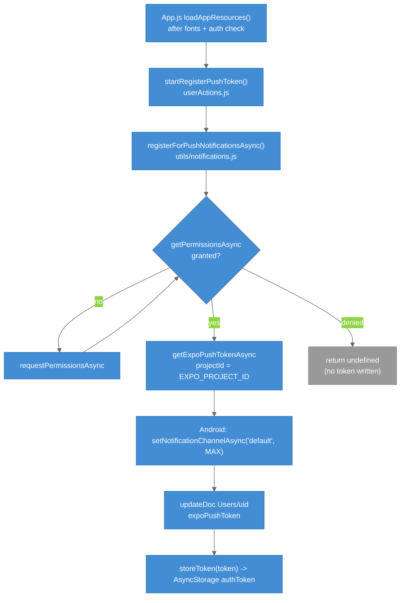

# Push Notifications (Client)

How the app registers for Expo push notifications, stores the token, and reacts when a coach-invite notification is tapped. The server side is in [[Cloud_Functions]].

---

## Overview

`expo-notifications` is configured at the top of `App.js` with `setNotificationHandler` (`shouldShowAlert`, `shouldPlaySound`, `shouldSetBadge` all true). Registration happens once per app launch after the auth check; the token is written to the athlete's Firestore document so the Cloud Function can address them.

Push requires a **development build** (`npm run android` or an EAS iOS dev client). Expo Go cannot receive remote pushes for this project.

---

## Registration

### Legend

- **Blue** = steps that run when permission is granted
- **Gray** = the denied path; no token is written
- **Default diamond** = the permission check

- `EXPO_PROJECT_ID` comes from `.env` via `@env` and must equal `app.json` `extra.eas.projectId`.
- One token per user: a second device overwrites the first. `clearPushTokenOnLogout` sets the field to `null` and clears AsyncStorage.
- The `Device.isDevice` guard is commented out, so the code runs on emulators too (and logs a failure there).

---

## Receiving

`App.js` registers two listeners (`addNotificationReceivedListener` for foreground display, `addNotificationResponseReceivedListener` for taps) and, on mount, checks `getLastNotificationResponseAsync()` for a tap that launched the app.

`handleNotificationResponse(response)`:

1. Ignore anything whose `actionIdentifier` is not the default tap.
2. Read `data = {screen, showPermissionsModal, coachId, coachFirstName, coachLastName}`.
3. If a cached `uid` exists and `screen === "Home" && showPermissionsModal`, store `{coachId, coachName}` in local state and dispatch `coachNotificationPermissionsModalVisible(true)`.

The modal itself then loads the pending list from Firestore; see [[Coach_Access_Permissions]].

Note: `getLastNotificationResponseAsync()` is called without `await` in the mount effect, so the launch-from-notification path receives a Promise, not a response, and never opens the modal directly; the boot-time `checkPendingPermissions` covers that case instead.

---

## Payload contract

| Key | Value | Set by |
|-----|-------|--------|
| `screen` | `"Home"` | `functions/index.js` |
| `showPermissionsModal` | `true` | `functions/index.js` |
| `coachId`, `coachFirstName`, `coachLastName` | from `Invitations/{id}` | `functions/index.js` |

---

## Local test helper

`sendNotification(title, body)` in `utils/notifications.js` schedules a local notification 1 s out. `HomeScreen` has a commented-out "Send Test Notification" button that calls it.

---

## Key Files

| File | Purpose |
|------|---------|
| `App.js` | Handler config, listeners, `handleNotificationResponse`, registration call |
| `src/utils/notifications.js` | `registerForPushNotificationsAsync`, `sendNotification` |
| `src/actions/userActions.js` | `startRegisterPushToken`, `clearPushTokenOnLogout` |
| `src/utils/localStorage.js` | `storeToken`, `getToken`, `clearToken` |
| `app.json` | `expo-notifications` plugin (icon, `defaultChannel`), `extra.eas.projectId`, iOS `aps-environment` |
| `__test__/__mocks__/expo-notifications.js` | Jest manual mock |
| `__test__/__unit-test__/__utils-test__/notifications.unit.test.js` | Unit tests (3 `projectId` cases commented out) |

---

## Tests

| Suite | Covers |
|-------|--------|
| `__test__/__unit-test__/__utils-test__/notifications.unit.test.js` | `registerForPushNotificationsAsync`; three projectId cases are commented out (see [[Known_Issues]]) |
| `__test__/__unit-test__/__actions-test__/userActions.unit.test.js` | `startRegisterPushToken` |
| `__test__/__integration-test__/userActions.integration.test.js` | Token registration against mocked Firebase |

See [[Testing]] for tooling and mocks.

---

## Related Notes

- [[Cloud_Functions]]
- [[Coach_Access_Permissions]]
- [[iOS_EAS_Build]]
- [[Environment_Setup]]
