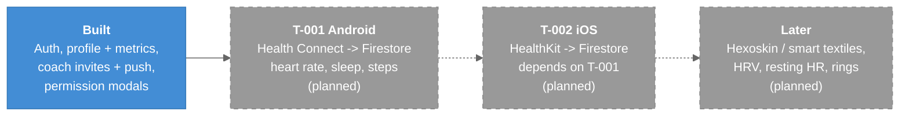

# Roadmap

What is built on `main` and what is *(planned)*, as of 2026-10-02 (`main @ f65e19f`).

---

## Overview

The app's long-term goal is to ingest vital signs from smart textiles and smartwatches and share them with coaches. Today the account, profile and coach-permission flows are real; every health number on screen is either a placeholder or read from collections nothing writes. The next milestone is the first real data path: a wearable feeding Firestore.

### Legend

- **Blue** = on `main` today
- **Gray dashed** = *(planned)*, not built
- **Dashed arrow** = a dependency between planned work

---

## Built

| Area | State | Note |
|------|-------|------|
| Email / password auth, session restore, logout, delete account | Working | [[Authentication]] |
| Profile and body-metrics form | Working | [[Profile_Settings]] |
| Coach invite -> Cloud Function -> Expo push | Working | [[Cloud_Functions]], [[Push_Notifications_Client]] |
| Pending-permission and coach-access modals | Working; the disable toggle does not persist | [[Coach_Access_Permissions]], [[Known_Issues]] #2 |
| Heart-rate and sleep screens | Query Firestore, but nothing writes the data | [[Health_Data_Screens]] |
| Home, Insights, Devices | **Hard-coded** placeholders | [[Home_Dashboard]], [[Insights_Activity_Rings]], [[Devices_Tab]] |

## Planned

| Item | Status | Ticket |
|------|--------|--------|
| Android smartwatch data via Health Connect *(planned)* | Draft | [[T-001_Android_Health_Connect]] |
| Apple Watch data via HealthKit *(planned)* | Draft, depends on T-001 | [[T-002_iOS_Apple_HealthKit]] |
| Tighter Firestore rules, with the dashboard team *(planned)* | Backlog | [[Known_Issues]] #1 |
| Hexoskin / smart-textile ingestion *(planned)* | Not ticketed | [[01-SystemLandscape]] |

Smaller fixes sit in the backlog table in [[Tickets/README|Tickets]]. Update this note when a ticket changes status or merges.

---

## Related Notes

- [[Known_Issues]]
- [[Tickets/README|Tickets]]
- [[00-C4-Overview]]
- [[Tech_Stack]]
