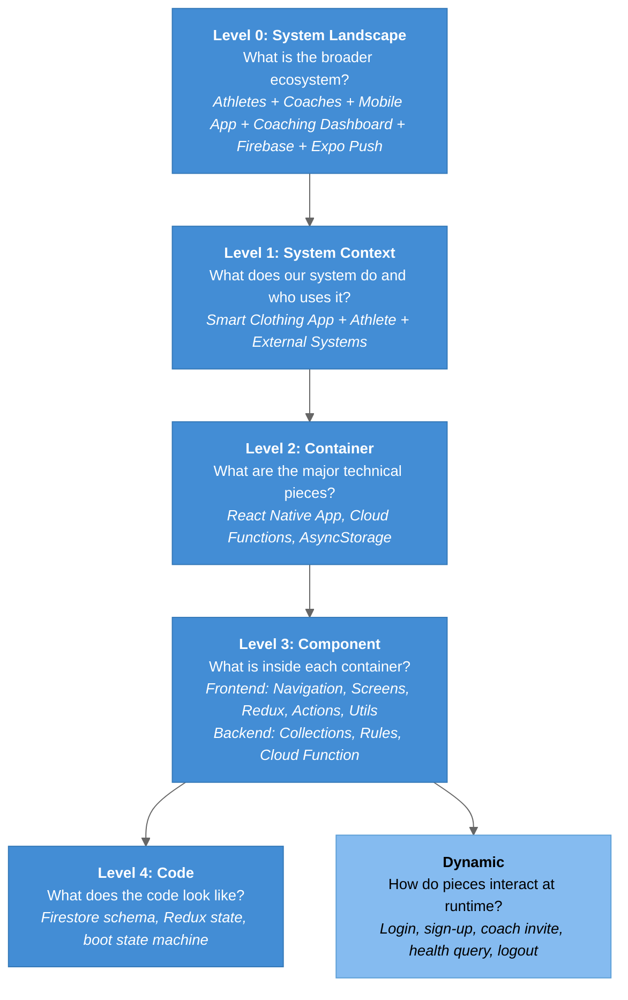

# C4 Model - Smart Clothing App Architecture

Index of the architecture diagrams, the shared diagram palette, and the decisions the diagrams make visible.

---

## What is the C4 Model?

The C4 model (Context, Containers, Components, Code), created by Simon Brown, is a set of hierarchical architecture diagrams. It describes a software system at four zoom levels, plus supplementary landscape and dynamic views.

## Diagram Index

| Level | Diagram | Description |
|-------|---------|-------------|
| **0** | [[01-SystemLandscape]] | CSUN ARCS ecosystem: athletes, coaches, admins, this app, the Coaching Dashboard, Firebase, Expo Push, planned wearables |
| **1** | [[02-SystemContext]] | The mobile app, its users, and the external systems it depends on |
| **2** | [[03-Container]] | React Native app, AsyncStorage cache, Cloud Functions; Firebase Auth, Firestore, Expo Push as externals |
| **3a** | [[04-Component-Frontend]] | Boot, navigation, screens, components, Redux, actions, utils |
| **3b** | [[05-Component-Backend]] | Firestore collections, rules, the invitation Cloud Function |
| **4** | [[06-Code]] | Firestore ER schema, Redux state shape, boot / auth state machine, pending-permissions check |
| **Dyn** | [[07-Dynamic-Diagrams]] | Login + restore, sign-up, coach invite push, health query, logout |

## C4 Abstraction Levels



### Legend

- **Blue** = C4 levels
- **Light blue** = supplementary dynamic view

---

## Diagram Conventions

Shared with the Coaching Dashboard, Momentum, VIP and Boracle vaults, so they all read the same. Every diagram, including sequence, ER, class and state diagrams, starts with this init line, verbatim:

```
%%{init: {'theme': 'base', 'flowchart': {'useMaxWidth': true}, 'themeVariables': {'primaryColor': '#438DD5', 'primaryTextColor': '#fff', 'lineColor': '#666', 'fontSize': '14px'}}}%%
```

| Element | Style | Usage |
|---------|-------|-------|
| Users / Actors | `fill:#08427B,color:#fff,stroke:#073B6F` | Athletes, coaches, admins |
| Main System | `fill:#1168BD,color:#fff,stroke:#0E5CA4` | The Smart Clothing App as a whole |
| Containers / Components | `fill:#438DD5,color:#fff,stroke:#3579B8` | What we build |
| Sub-components / helpers | `fill:#85BBF0,color:#000,stroke:#5D9FD6` | Smaller pieces inside a component |
| External Systems | `fill:#999,color:#fff,stroke:#888` | Firebase services, Expo Push, the Coaching Dashboard |
| Planned / not implemented | external style + `,stroke-dasharray: 5 5`, arrows `-.->` | Wearable ingestion and anything else not on `main` |
| Problem path | `fill:#C94C4C,color:#fff,stroke:#8D3535` | Sparingly, for a path that fails |
| Boundaries | `fill:#E8E8E8,color:#333,stroke:#BBB` | Subgraph background |

Rules:

- Node labels look like `id["<b>Name</b><br/>short description"]`. No HTML entities, no semicolons, no `{}` braces inside labels, ASCII only.
- Sequence diagrams wrap **every** message in a dark `rect` block: `rgb(46, 110, 70)` green, `rgb(40, 85, 140)` blue, `rgb(140, 50, 50)` red, `rgb(95, 95, 95)` gray. The init line makes message text white, so light fills make it unreadable.
- A `### Legend` follows every diagram and names only what that diagram uses.
- This is the **diagram** palette. It is unrelated to the app's `AppColor` theme in `src/constants/themes.js`.

Diagram types:

- `flowchart TD` / `graph TD` for landscape, context, container, component and small feature flows
- `sequenceDiagram` with `rect rgb(...)` blocks for dynamic flows
- `erDiagram` for the Firestore schema
- `classDiagram` for the Redux state shape
- `stateDiagram-v2` for boot / auth states

---

## Key Architecture Decisions Visible in Diagrams

| Decision | Visible In | Diagram |
|----------|-----------|---------|
| Firebase-only backend, no application server of our own | Container | The app talks to Firebase Auth + Firestore directly with the Firebase JS SDK |
| Firebase JS SDK (`firebase/*`), not `@react-native-firebase` | Component - Frontend | `firebaseConfig.js` exports `auth` + `database`; RN-Firebase packages are installed but unused |
| Redux 4 + redux-thunk, all Firebase access in `userActions.js` | Component - Frontend | Thunks prefixed `start...` wrap every Firestore / Auth call |
| AsyncStorage mirror of identity + metrics (`localStorage.js`) | Code | Boot state machine restores `uid` before Firestore is queried |
| Push notifications via Expo, triggered by a Firestore `onCreate` Cloud Function | Dynamic - Coach Invite | `Invitations/{id}` create -> look up athlete by email -> Expo push |
| **Firestore is the integration point with the Coaching Dashboard** | Landscape | Both systems read / write the same `Users/{uid}` documents; the dashboard is a separate repo |
| Wearable data ingestion is **not implemented** | Landscape, Container | Dashed node; see [[Roadmap]], [[T-001_Android_Health_Connect]], [[T-002_iOS_Apple_HealthKit]] |
| Schema divergence between app and dashboard | Code | App reads `HeartRateData` / `SleepData`; dashboard reads `HeartRateDataHC` / `SleepDataHC` / `VO2MaxDataHX` with different field names |

---

## Related Notes

- [[SystemDesign/README|System Design]]
- [[Project_Structure]]
- [[Tech_Stack]]
- [[Known_Issues]]
