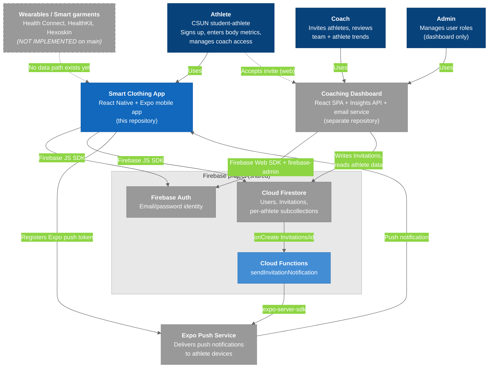

# C4 Model - Level 0: System Landscape Diagram

The broadest view: every person and software system in the ARCS smart-textile research ecosystem, and how the Smart Clothing App fits alongside the separately-developed Coaching Dashboard.

## Diagram

### Legend

- **Dark blue** = Users / Actors
- **Blue** = Smart Clothing App system (what we build)
- **Light blue** = Container we own inside a shared service (the Cloud Function lives in this repo's `functions/`)
- **Gray** = External systems (third-party, or the separate Coaching Dashboard repo)
- **Gray dashed node + dashed arrow** = *(planned)*, not implemented on `main`; shown only so the gap is visible
- **Light border** = boundary subgraph

## Key Relationships

| Relationship | Protocol | Purpose |
|-------------|----------|---------|
| Athlete -> Smart Clothing App | Touch UI | Sign up / log in, enter metrics, view health screens, manage coach permissions |
| Coach / Admin -> Coaching Dashboard | HTTPS | Invite athletes, view aggregated data, manage roles |
| Smart Clothing App -> Firebase Auth | Firebase JS SDK | `createUserWithEmailAndPassword`, `signInWithEmailAndPassword`, `onAuthStateChanged`, reauth |
| Smart Clothing App -> Firestore | Firebase JS SDK | `Users/{uid}` profile + metrics, `pendingPermissions` / `coachList`, `expoPushToken`; reads `HeartRateData` / `SleepData` |
| Coaching Dashboard -> Firestore | Firebase Web SDK (SPA), firebase-admin (API) | Writes `Invitations/{id}`, sets `Users/{uid}.role`, reads `HeartRateDataHC` / `SleepDataHC` / `VO2MaxDataHX` |
| Firestore -> Cloud Functions | Firestore trigger | `Invitations/{id}` `onCreate` fires `sendInvitationNotification` |
| Cloud Functions -> Expo Push | HTTPS (`expo-server-sdk`) | Sends the "Allow Coach ... to Track Your Data?" notification |
| Expo Push -> Smart Clothing App | APNs / FCM | Delivers notification; tap opens `NotificationPermissionsModal` |

## Systems

| System | Repository | Status |
|--------|-----------|--------|
| **Smart Clothing App** | `smart-clothing-app/SmartClothingApp` | Active — this vault documents it |
| **Coaching Dashboard** | `coaching-dashboard` (sibling repo) | Active, separate team; reads the same Firestore project |
| **Cloud Functions** | `smart-clothing-app/SmartClothingApp/functions` | Deployed from this repo |
| **Wearable ingestion** | — | Not implemented; see [[T-001_Android_Health_Connect]] |

---

## Related Notes

- [[00-C4-Overview]]
- [[02-SystemContext]]
- [[Roadmap]]
- [[T-001_Android_Health_Connect]]
- [[T-002_iOS_Apple_HealthKit]]
