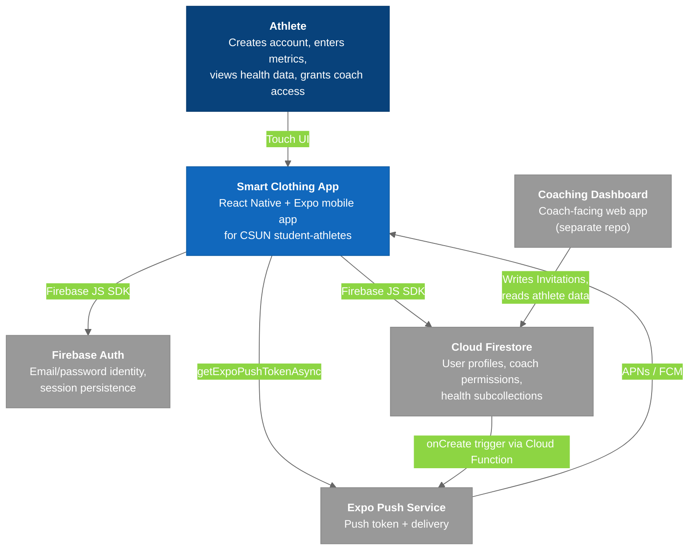

# C4 Model - Level 1: System Context Diagram

The highest level of abstraction showing the Smart Clothing App and its direct relationships with users and external systems.

## Diagram

### Legend

- **Dark blue** = Users / Actors
- **Blue** = Smart Clothing App system (what we build)
- **Gray** = External systems (third-party)

## Key Relationships

| Relationship | Protocol | Purpose |
|-------------|----------|---------|
| Athlete -> Smart Clothing App | Touch UI | All athlete interactions through the React Native app |
| Smart Clothing App -> Firebase Auth | Firebase JS SDK v10 (`firebase/auth`) | Sign up, sign in, password reset, reauthentication, email/password change, account deletion; session persisted with `getReactNativePersistence(AsyncStorage)` |
| Smart Clothing App -> Firestore | Firebase JS SDK v10 (`firebase/firestore`) | `Users/{uid}` CRUD, `pendingPermissions` / `coachList` array ops, `expoPushToken`, date-range queries on `HeartRateData` / `SleepData` |
| Smart Clothing App -> Expo Push | `expo-notifications` | Requests permission and registers an Expo push token (`EXPO_PROJECT_ID`) |
| Expo Push -> Smart Clothing App | APNs / FCM | Delivers coach-invite notifications; tap payload `{screen, showPermissionsModal, coachId, coachFirstName, coachLastName}` |
| Coaching Dashboard -> Firestore | Firebase Web SDK + firebase-admin | Creates `Invitations/{id}` (which triggers the push), sets `Users/{uid}.role`, reads health subcollections |

## Actors

| Actor | Role | Primary Actions |
|-------|------|-----------------|
| **Athlete** | Only role the mobile app knows about | Sign up / log in, enter gender / DOB / height / weight / sport, view Home dashboard + Health tab, accept or remove coach access, change email / password, delete account |

## External System Dependencies

| System | Criticality | Failure Impact |
|--------|-------------|----------------|
| **Firebase Auth** | Critical | No login or sign-up; app stays on `AuthStack` |
| **Cloud Firestore** | Critical | No profile load/save, no coach permissions, empty health screens |
| **Expo Push Service** | Medium | Coach invites still land in `Users/{uid}.pendingPermissions` and surface on next app open; only the real-time notification is lost |
| **Coaching Dashboard** | Low (for the app) | The app functions without it; coach invites simply never arrive |

---

## Related Notes

- [[01-SystemLandscape]]
- [[03-Container]]
- [[Firebase_Auth]]
- [[Push_Notifications_Client]]
