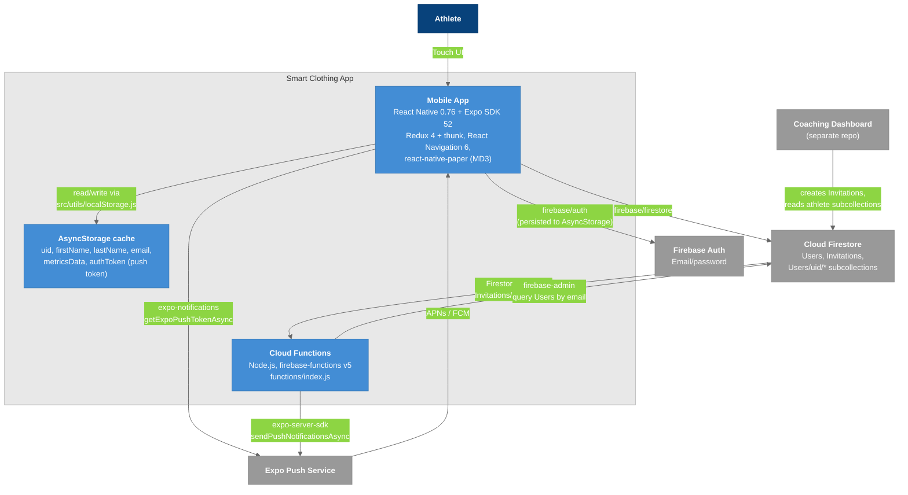

# C4 Model - Level 2: Container Diagram

Zooming into the Smart Clothing App system to show its separately runnable / deployable pieces and the Firebase services they depend on.

## Diagram

### Legend

- **Dark blue** = Users / Actors
- **Light blue** = Containers (individual technical building blocks we build and deploy)
- **Gray** = External systems (Firebase managed services, Expo, the separate dashboard)

## Containers

| Container | Technology | Location | Responsibility |
|-----------|-----------|----------|----------------|
| **Mobile App** | React Native 0.76.3, Expo ~52, React 18.3, Redux 4 + redux-thunk, React Navigation 6, react-native-paper 5, react-native-chart-kit, victory-native + Skia | `SmartClothingApp/App.js`, `src/` | All UI; every Firebase call; push token registration; notification-tap handling |
| **AsyncStorage cache** | `@react-native-async-storage/async-storage` | `src/utils/localStorage.js` | Mirrors identity + metrics so the app can restore the session before Firestore answers; also the Firebase Auth persistence layer |
| **Cloud Functions** | Node.js, `firebase-functions@5`, `firebase-admin@12`, `expo-server-sdk` | `SmartClothingApp/functions/index.js` | `sendInvitationNotification` (Firestore trigger) and a `helloWorld` HTTPS stub |

## Key Relationships

| Relationship | Protocol | Purpose |
|-------------|----------|---------|
| Mobile App -> AsyncStorage | Async key/value | `storeUID` / `getUID`, `storeMetrics` / `getMetrics`, names, email, push token; cleared on logout and account deletion |
| Mobile App -> Firebase Auth | Firebase JS SDK | `initializeAuth(app, { persistence: getReactNativePersistence(AsyncStorage) })` in `firebaseConfig.js` |
| Mobile App -> Firestore | Firebase JS SDK | `doc`, `getDoc`, `setDoc`, `updateDoc`, `deleteDoc`, `arrayUnion`, `arrayRemove`, `query` + `where` + `orderBy` on subcollections |
| Mobile App -> Expo Push | `expo-notifications` | Permission prompt, token retrieval with `EXPO_PROJECT_ID`, Android channel `default` |
| Firestore -> Cloud Functions | Firestore trigger | `functions.firestore.document("Invitations/{invitationId}").onCreate` |
| Cloud Functions -> Expo Push | HTTPS | Push message with `data: {screen: "Home", showPermissionsModal: true, coachId, coachFirstName, coachLastName}` |

## What is not here

- **No application server.** There is no Express/REST layer; `src/network/NetworkManager.js` is an unused axios scaffold with an empty `baseUrl`.
- **No wearable or health-platform container.** Health Connect, HealthKit, Bluetooth, and the Hexoskin API are absent from `package.json` and `src/`. See [[Devices_Tab]] and [[T-001_Android_Health_Connect]].

---

## Related Notes

- [[02-SystemContext]]
- [[04-Component-Frontend]]
- [[05-Component-Backend]]
- [[Firebase_Setup]]
- [[Tech_Stack]]
