# C4 Model - Level 3a: Component Diagram (Frontend)

Inside the Mobile App container: how boot, navigation, screens, Redux, actions, and utilities are organised, and where Firebase is touched.

## Diagram

```mermaid
%%{init: {'theme': 'base', 'flowchart': {'useMaxWidth': true}, 'themeVariables': {'primaryColor': '#438DD5', 'primaryTextColor': '#fff', 'lineColor': '#666', 'fontSize': '14px'}}}%%
flowchart TD
    subgraph boot["Boot"]
        appjs["<b>App.js</b><br/>configureStore(), fonts,<br/>onAuthStateChanged, restoreUUID,<br/>push token, notification listeners"]
        fbconfig["<b>firebaseConfig.js</b><br/>initializeApp, initializeAuth,<br/>getFirestore -> auth, database"]
    end

    subgraph nav["Navigation (src/navigation)"]
        router["<b>index.js AppRouter</b><br/>state.user.uuid ? Main : Auth"]
        authstack["<b>AuthStack</b><br/>SignIn, SignUp, ForgotPassword"]
        homestack["<b>HomeStack.jsx AllNavigationStack</b><br/>Main tabs + Insights, Profile,<br/>DeviceDetails, Settings, Accessibility"]
        tabs["<b>MainTabNavigator</b><br/>Home | HealthTab | Device"]
    end

    subgraph screens["Screens (src/screens)"]
        home["<b>HomeScreen</b><br/>DailyInsights, ActivityCards,<br/>Breathing / Ventilation / HR charts"]
        health["<b>ViewHealthData</b><br/>-> ViewHeartRateData, ViewSleepData"]
        devices["<b>MyDevices / DeviceDetails</b><br/>static device list"]
        insights["<b>ViewInsights</b><br/>ActivityRings + ActivityChart"]
        settings["<b>Settings / Profile / Accessibility</b><br/>modals: email, password, delete,<br/>ToS, PermissionsModal"]
    end

    subgraph components["Shared components (src/components)"]
        modals["<b>Modals</b><br/>DataCollectModal, PermissionsModal,<br/>NotificationPermissionsModal, ..."]
        viz["<b>visualizations</b><br/>ActivityRings (Skia), ActivityChart,<br/>BreathingRateChart, VentilationChart,<br/>HeartRateChart (chart-kit)"]
        toolbar["<b>DateToolbar</b><br/>single / period date pickers"]
    end

    subgraph redux["Redux (src/store.js)"]
        store["<b>store</b><br/>combineReducers + thunk"]
        userR["<b>user</b>"]
        appR["<b>app</b>"]
        deviceR["<b>device</b>"]
        toastR["<b>toast</b>"]
    end

    subgraph actions["Actions (src/actions)"]
        userA["<b>userActions.js</b><br/>auth, profile, metrics, coach access,<br/>push token, querySleepData, queryHeartRateData"]
        appA["<b>appActions.js</b><br/>modal flags, date ranges,<br/>updateActivityRings (random)"]
        deviceA["<b>deviceActions.js</b><br/>push token helpers only"]
        toastA["<b>toastActions.js</b>"]
    end

    subgraph utils["Utils (src/utils)"]
        local["<b>localStorage.js</b><br/>AsyncStorage helpers"]
        notif["<b>notifications.js</b><br/>registerForPushNotificationsAsync"]
        misc["<b>calendar, dateConversions,<br/>metrics, scale, firebaseErrorMessages</b>"]
    end

    appjs --> fbconfig
    appjs --> store
    appjs --> router
    appjs --> local
    appjs --> notif
    router --> authstack
    router --> homestack
    homestack --> tabs
    tabs --> home
    tabs --> health
    tabs --> devices
    homestack --> insights
    homestack --> settings

    home --> viz
    home --> modals
    health --> toolbar
    health --> viz
    settings --> modals

    screens -->|"useSelector / useDispatch"| store
    components -->|"useSelector / useDispatch"| store
    store --> userR
    store --> appR
    store --> deviceR
    store --> toastR

    screens --> userA
    components --> userA
    components --> appA
    userA --> fbconfig
    userA --> local
    userA --> notif
    userA --> toastA

    style appjs fill:#438DD5,color:#fff,stroke:#3579B8
    style fbconfig fill:#438DD5,color:#fff,stroke:#3579B8
    style router fill:#438DD5,color:#fff,stroke:#3579B8
    style authstack fill:#438DD5,color:#fff,stroke:#3579B8
    style homestack fill:#438DD5,color:#fff,stroke:#3579B8
    style tabs fill:#438DD5,color:#fff,stroke:#3579B8
    style home fill:#438DD5,color:#fff,stroke:#3579B8
    style health fill:#438DD5,color:#fff,stroke:#3579B8
    style devices fill:#438DD5,color:#fff,stroke:#3579B8
    style insights fill:#438DD5,color:#fff,stroke:#3579B8
    style settings fill:#438DD5,color:#fff,stroke:#3579B8
    style modals fill:#438DD5,color:#fff,stroke:#3579B8
    style viz fill:#438DD5,color:#fff,stroke:#3579B8
    style toolbar fill:#438DD5,color:#fff,stroke:#3579B8
    style store fill:#438DD5,color:#fff,stroke:#3579B8
    style userR fill:#438DD5,color:#fff,stroke:#3579B8
    style appR fill:#438DD5,color:#fff,stroke:#3579B8
    style deviceR fill:#438DD5,color:#fff,stroke:#3579B8
    style toastR fill:#438DD5,color:#fff,stroke:#3579B8
    style userA fill:#438DD5,color:#fff,stroke:#3579B8
    style appA fill:#438DD5,color:#fff,stroke:#3579B8
    style deviceA fill:#438DD5,color:#fff,stroke:#3579B8
    style toastA fill:#438DD5,color:#fff,stroke:#3579B8
    style local fill:#438DD5,color:#fff,stroke:#3579B8
    style notif fill:#438DD5,color:#fff,stroke:#3579B8
    style misc fill:#438DD5,color:#fff,stroke:#3579B8
    style boot fill:#E8E8E8,color:#333,stroke:#BBB
    style nav fill:#E8E8E8,color:#333,stroke:#BBB
    style screens fill:#E8E8E8,color:#333,stroke:#BBB
    style components fill:#E8E8E8,color:#333,stroke:#BBB
    style redux fill:#E8E8E8,color:#333,stroke:#BBB
    style actions fill:#E8E8E8,color:#333,stroke:#BBB
    style utils fill:#E8E8E8,color:#333,stroke:#BBB
```

### Legend

- **Light blue** = Components inside the Mobile App container
- **Gray boxes** = Logical groupings (folders under `src/`)

## Components

| Component | Files | Responsibility |
|-----------|-------|----------------|
| **Boot** | `App.js`, `firebaseConfig.js` | Create the store at module scope; load fonts; subscribe to `onAuthStateChanged`; restore `uid` + metrics from AsyncStorage; register push token; wire notification listeners; decide whether `NotificationPermissionsModal` opens |
| **Navigation** | `src/navigation/index.js`, `AuthStack.jsx`, `HomeStack.jsx` | `AppRouter` renders `AuthStack` when `state.user.uuid` is null, else `AllNavigationStack` (default export of `HomeStack.jsx`) |
| **Screens** | `src/screens/*` (barrel `index.js`) | One folder per screen: `HomeScreen`, `ViewHealthData`, `ViewHeartRateData`, `ViewSleepData`, `ViewInsights`, `MyDevices`, `DeviceDetails`, `Profile`, `Settings`, `Accessibility`, `SigninScreen`, `SignupScreen`, `ForgotPasswordScreen` |
| **Shared components** | `src/components/*` (barrel `index.js`) | `AppHeader`, `AppCards`, modals, `DailyInsights`, `DailyMetrics`, `DateToolbar`, `UI/*`, `visualizations/*`, `Dialogs/AppToast` |
| **Redux** | `src/store.js`, `src/reducers/*` | `user`, `app`, `device`, `toast` reducers; `redux-thunk` middleware; action type strings in `src/actions/types.js` |
| **Actions** | `src/actions/*` | `userActions.js` owns nearly all Firebase Auth + Firestore access (`start...` thunks plus non-thunk `querySleepData` / `queryHeartRateData` / `fetchUserData`) |
| **Utils** | `src/utils/*` | AsyncStorage wrappers, push registration, calendar helpers, unit conversions, Firebase error message map |
| **Constants** | `src/constants/themes.js`, `errors.js` | MD3 theme (`AppTheme`, `AppColor`, `AppFonts`, `AppStyle`) |

## Key Relationships

| Relationship | Mechanism | Purpose |
|-------------|-----------|---------|
| Screens / components -> Redux | `useSelector`, `useDispatch` | Read `state.user`, `state.app`, `state.device`; dispatch thunks |
| `userActions.js` -> Firebase | `auth`, `database` from `firebaseConfig.js` | Every Auth and Firestore call in the app |
| `userActions.js` -> AsyncStorage | `localStorage.js` | Keep the on-device mirror in sync after login, signup, profile update, logout |
| `App.js` -> `NotificationPermissionsModal` | Redux flag `coachNotificationPermissionsModalVisible` + props `coachId`, `coachName` | Opened on notification tap or when `pendingPermissions` is non-empty |

## Unused / dead code worth knowing

- `HomeNavigationStack`, `DevicesNavigationStack`, `InsightsNavigationStack` in `HomeStack.jsx` are defined but never mounted.
- `src/services/index.js` is empty (`export {}`); `src/network/` is an unused axios client.
- `deviceReducer` `GET_DEVICES` case returns the array instead of state; nothing dispatches it.

---

## Related Notes

- [[03-Container]]
- [[06-Code]]
- [[Navigation]]
- [[Redux_State]]
- [[Project_Structure]]
