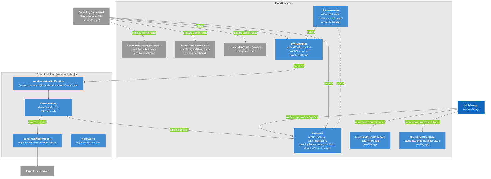

# C4 Model - Level 3b: Component Diagram (Backend)

Inside the Firebase side of the system: the Firestore collections the app depends on, the security rules that guard them, and the one Cloud Function deployed from this repository. The Coaching Dashboard is shown because it reads and writes the same documents.

## Diagram

### Legend

- **Blue** = The mobile app (caller)
- **Light blue** = Components this repository defines or depends on directly (collections it reads/writes, rules, functions)
- **Gray** = External systems, and collections that only the Coaching Dashboard uses today

## Components

| Component | Defined in | Responsibility |
|-----------|-----------|----------------|
| **`Users/{uid}`** | Created by `startSignupWithEmail`; updated by profile / metrics / coach-access thunks | Single document per athlete. Also carries `role` written by the dashboard's admin tools |
| **`Users/{uid}/HeartRateData`, `SleepData`** | Read by `queryHeartRateData`, `querySleepData` | Health time-series in the shape the app's Health tab parses. **No writer exists in this repo.** |
| **`Users/{uid}/HeartRateDataHC`, `SleepDataHC`, `VO2MaxDataHX`** | Read by `coaching-dashboard/server/server.js` | Health time-series in raw Health Connect / Hexoskin shapes. **Not read or written by this app.** |
| **`Invitations/{id}`** | Written by the Coaching Dashboard | Triggers the push; the app never reads it |
| **`firestore.rules`** | `SmartClothingApp/firestore.rules` | Any authenticated user may read and write any document (catch-all `match /{document=**}`) |
| **`sendInvitationNotification`** | `functions/index.js` | On invite create: find the athlete by `email`, and if they have an `expoPushToken`, send "Allow Coach {name} to Track Your Data?" with the navigation payload |
| **`helloWorld`** | `functions/index.js` | Default HTTPS stub, unused |

## Key Relationships

| Relationship | Protocol | Purpose |
|-------------|----------|---------|
| Mobile App -> `Users/{uid}` | Firebase JS SDK | `setDoc` at signup; `updateDoc` for metrics, `expoPushToken`, `arrayUnion` / `arrayRemove` on `pendingPermissions` + `coachList`; `deleteDoc` on account deletion |
| Mobile App -> health subcollections | Firebase JS SDK `query` | `where("date", ">=", start)`, `where("date", "<=", end)`; sleep adds `orderBy("startDate")` and a client-side `endDate` filter |
| Dashboard -> Firestore | Firebase Web SDK + firebase-admin | Invitations, role changes, per-athlete time-series reads |
| Invitations -> Cloud Function -> Expo | Firestore trigger, HTTPS | Real-time coach invite notification |

## Known gaps

- **Schema divergence.** The app and the dashboard read different subcollections with different field names. Any ingestion work must pick one contract; see [[Firestore_Schema]] and [[T-001_Android_Health_Connect]].
- **Rules are wide open** for authenticated users; an athlete can read any other athlete's document. See [[Firestore_Rules]].
- `disabledCoachList` is written at signup but `fetchCoachAccess` reads `CoachListDisabled` (different casing); the disable feature is partially wired.

---

## Related Notes

- [[03-Container]]
- [[06-Code]]
- [[Firestore_Schema]]
- [[Firestore_Rules]]
- [[Cloud_Functions]]
