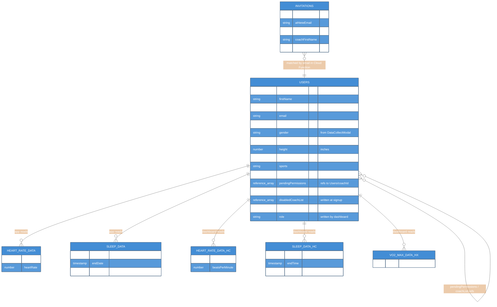
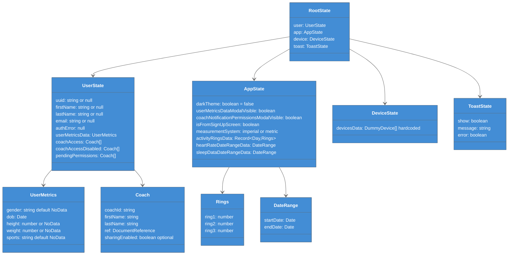
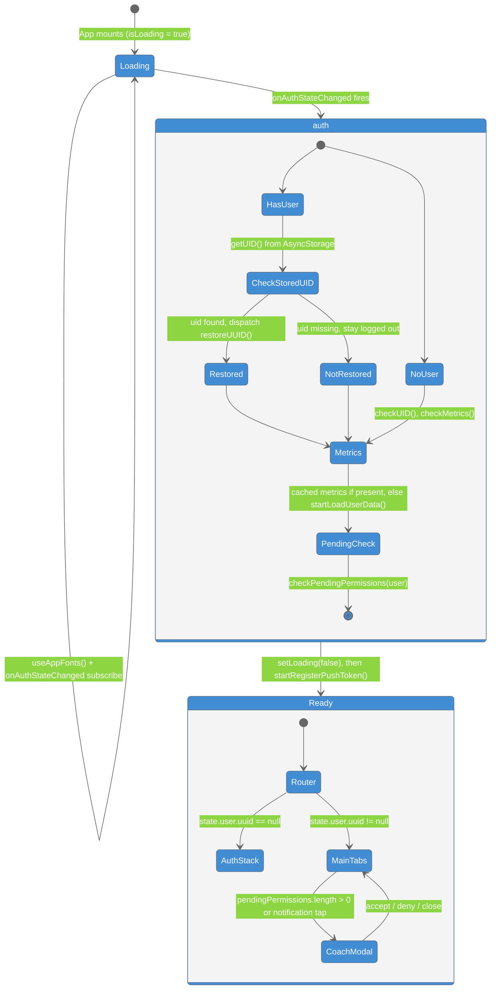
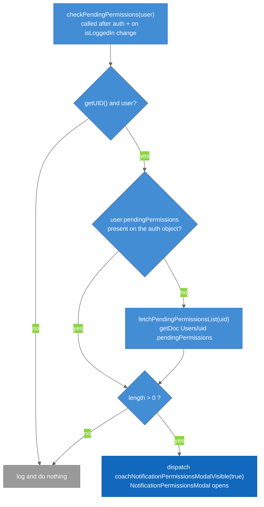

# C4 Model - Level 4: Code Diagrams

Code-level detail for the parts of the system where structure matters most: the Firestore document schema, the Redux state shape, the boot / auth state machine in `App.js`, and the pending-permissions check that decides whether the coach modal opens.

## 1. Firestore Schema

### Legend

- **Entities** = Firestore collections and subcollections; `PK` is the document id
- **Relationship labels** = which system reads the subcollection (the app or the Coaching Dashboard)

Nothing in this repository writes to any of the five health subcollections. See [[Firestore_Schema]] for the full field reference.

---

## 2. Redux State Shape

### Legend

- **Classes** = Redux slices and the shapes stored in them; arrows point from a slice to the types it holds

Reducers: `src/reducers/{userReducer,appReducer,deviceReducer,toastReducer}.js`; combined in `src/store.js` with `redux-thunk`. See [[Redux_State]].

---

## 3. Boot / Auth State Machine (`App.js`)

### Legend

- **States** = what `App.js` renders while booting; `auth` and `Ready` are composite states
- **Transitions** = the event or check that moves the app on

Notes:
- The store is created once at module scope (`const store = configureStore()`), so Redux state survives re-renders but not app restarts; AsyncStorage is what makes login sticky.
- Firebase Auth has its own persisted session (`getReactNativePersistence`), so `onAuthStateChanged` normally fires with a user on cold start; the app still requires the AsyncStorage `uid` to consider itself logged in.

---

## 4. Pending-Permissions Check

### Legend

- **Blue** = steps the app runs
- **Dark blue** = the outcome the athlete sees (the modal opens)
- **Gray** = the silent no-op path

`NotificationPermissionsModal` then dispatches `fetchPendingPermissions()` itself to resolve each coach reference into `{coachId, firstName, lastName, ref}` before rendering the list. See [[Coach_Access_Permissions]].

---

## Key Relationships

| Relationship | Protocol | Purpose |
|-------------|----------|---------|
| `Users/{uid}` → coach `Users` docs | Firestore DocumentReference arrays | `pendingPermissions`, `coachList`, disabled lists |
| `Invitations` → `Users` | Email match in the Cloud Function | Finds the athlete to push to |
| Redux `user` slice ↔ AsyncStorage | `src/utils/localStorage.js` | Survives app restarts |
| `App.js` boot ↔ Firebase Auth | `onAuthStateChanged` | Restores the session before routing |

## Related Notes

- [[Firestore_Schema]]
- [[Redux_State]]
- [[Authentication]]
- [[Coach_Access_Permissions]]
- [[07-Dynamic-Diagrams]]
