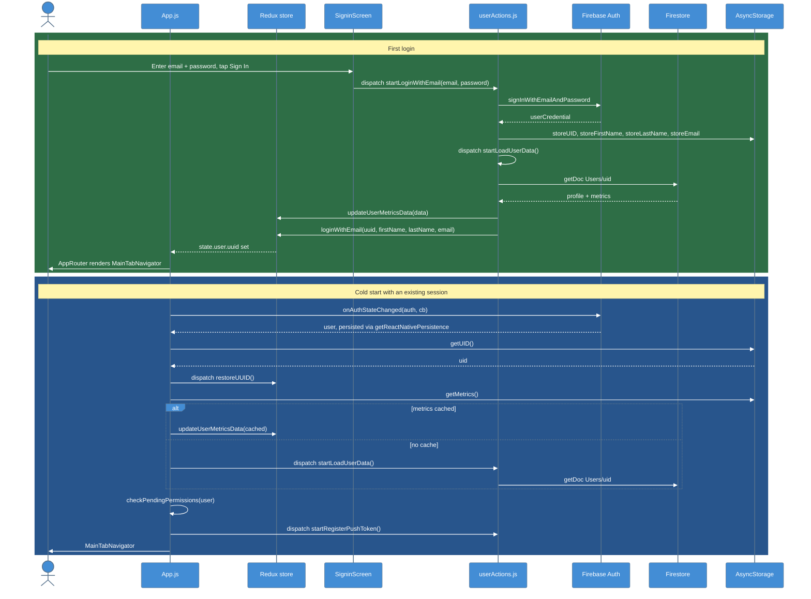
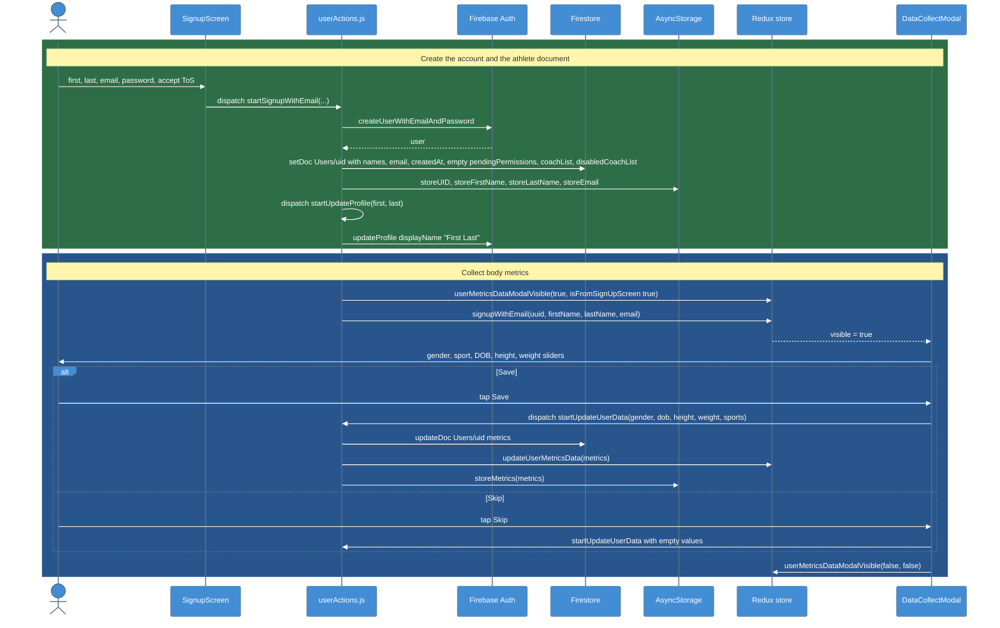
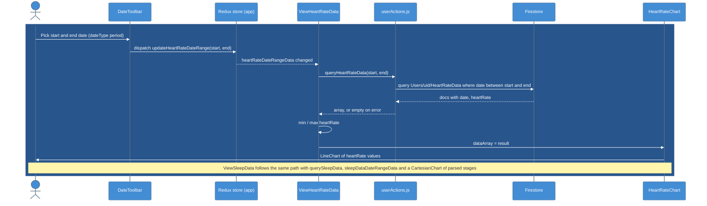

# C4 Model - Dynamic Diagrams

Runtime behavior of the key interaction flows on `main`: login and session restore, sign-up, the coach invite push, the health-tab query, and logout.

Every message sits inside a dark `rect` block, because the shared init line renders message text white. Colours mean the same thing in every diagram below.

---

## 1. Login + Session Restore

### Legend

- **Green** = first login through `SigninScreen`
- **Blue** = cold start, where the AsyncStorage `uid` decides whether the athlete is logged in

---

## 2. Sign-up + Metrics Collection

### Legend

- **Green** = account creation and the first write of `Users/uid`
- **Blue** = the metrics modal that opens straight after sign-up

---

## 3. Coach Invite -> Push Notification -> Permission Grant

```mermaid
%%{init: {'theme': 'base', 'flowchart': {'useMaxWidth': true}, 'themeVariables': {'primaryColor': '#438DD5', 'primaryTextColor': '#fff', 'lineColor': '#666', 'fontSize': '14px'}}}%%
sequenceDiagram
    actor Coach
    participant Dash as Coaching Dashboard
    participant FS as Firestore
    participant Fn as Cloud Function<br/>sendInvitationNotification
    participant Expo as Expo Push Service
    participant App as App.js
    participant Modal as NotificationPermissionsModal
    participant Actions as userActions.js
    actor Athlete

    rect rgb(95, 95, 95)
    Note over Coach,FS: External - the Coaching Dashboard repo
    Coach->>Dash: Invite athlete by email
    Dash->>FS: addDoc Invitations with athleteEmail, coachId, coach names
    end

    rect rgb(46, 110, 70)
    Note over FS,Expo: Server side - functions/index.js
    FS->>Fn: onCreate Invitations/invitationId
    Fn->>FS: Users where email == athleteEmail
    FS-->>Fn: athlete doc with expoPushToken
    Fn->>Expo: sendPushNotificationsAsync to token, data screen Home, showPermissionsModal true, coach id and names
    end

    rect rgb(40, 85, 140)
    Note over Expo,Athlete: Client side - App.js and the modal
    Expo-->>Athlete: Notification "Allow Coach X to Track Your Data?"
    Athlete->>App: Tap notification
    App->>App: handleNotificationResponse(response)
    App->>App: getUID() and screen == Home and showPermissionsModal
    App->>Modal: setRecentNotificationCoach, dispatch coachNotificationPermissionsModalVisible(true)
    Modal->>Actions: dispatch fetchPendingPermissions()
    Actions->>FS: getDoc Users/uid .pendingPermissions, then getDoc each coach ref
    FS-->>Actions: list of coachId, firstName, lastName, ref
    Modal->>Athlete: List of pending coaches
    alt Allow
        Athlete->>Modal: Allow
        Modal->>Actions: removeFromPendingPermissions(coach) - updateDoc arrayRemove
        Modal->>Actions: startAddToCoachAccess(coach) - updateDoc coachList arrayUnion
    else Deny
        Athlete->>Modal: Deny
        Modal->>Actions: removeFromPendingPermissions(coach)
    end
    Modal->>App: coachNotificationPermissionsModalVisible(false)
    end
```

### Legend

- **Gray** = the external Coaching Dashboard
- **Green** = the Cloud Function in this repo (`functions/index.js`)
- **Blue** = the mobile app handling the tap and the athlete's decision

The dashboard is expected to have already appended the coach's document reference to `Users/{uid}.pendingPermissions`; the push only wakes the athlete. If the app is not open, the same modal opens on the next launch via `checkPendingPermissions` (see [[06-Code]], section 4).

---

## 4. Health Tab: Date Range -> Firestore Query -> Chart

### Legend

- **Blue** = the whole query path, which runs entirely in the app

Nothing in this repository ever writes these documents; the query returns `[]` for a fresh user. See [[Health_Data_Screens]].

---

## 5. Logout

```mermaid
%%{init: {'theme': 'base', 'flowchart': {'useMaxWidth': true}, 'themeVariables': {'primaryColor': '#438DD5', 'primaryTextColor': '#fff', 'lineColor': '#666', 'fontSize': '14px'}}}%%
sequenceDiagram
    actor Athlete
    participant Settings as SettingsScreen
    participant Actions as userActions.js
    participant FS as Firestore
    participant Auth as Firebase Auth
    participant AS as AsyncStorage
    participant Store as Redux store

    rect rgb(95, 95, 95)
    Athlete->>Settings: Tap Log out
    Settings->>Actions: dispatch startLogout()
    Actions->>Actions: dispatch clearPushTokenOnLogout()
    Actions->>FS: updateDoc Users/uid expoPushToken null
    Actions->>AS: clearToken()
    Actions->>Auth: signOut()
    Actions->>AS: clearUID, clearMetrics, clearFirstName, clearLastName, clearEmail
    Actions->>Store: logout()
    Actions->>Store: toastError "User logged out!"
    Store-->>Athlete: AppRouter renders AuthStack
    end
```

### Legend

- **Gray** = teardown: push token, Firebase session and AsyncStorage cache are all cleared

`deleteAccount()` follows the same shape but calls `user.delete()`, then `deleteDoc(Users/{uid})`, then `signOut()`. Health subcollections are not deleted (Firestore does not cascade).

---

## Key Relationships

| Relationship | Protocol | Purpose |
|-------------|----------|---------|
| App ↔ Firebase Auth | Firebase JS SDK | Sign-in, sign-up, persisted session, sign-out |
| App ↔ Firestore | Firebase JS SDK | `Users/{uid}` profile, metrics, coach refs, health queries |
| App ↔ AsyncStorage | Local key-value | `uid` and metrics cache that makes login sticky |
| Dashboard → Firestore → Cloud Function | `onCreate` trigger | A new invitation fires the push |
| Cloud Function → Expo Push → device | HTTPS | Wakes the athlete to grant coach access |

## Related Notes

- [[06-Code]]
- [[04-Component-Frontend]]
- [[05-Component-Backend]]
- [[Authentication]]
- [[Coach_Access_Permissions]]
- [[Push_Notifications_Client]]
- [[Cloud_Functions]]
