now
# T-009-P1: Phase 1 - Service: 5-minute heart rate and VO2 max

Phase 1 of [[T-009_Save_Daily_Stats_To_Firestore]]. Only `insights-service/` changes: no app changes and no Firebase writes.

## Summary

The day that `insights-service` returns (`GET /api/fitbit/day/:date`, also used by `/api/insights/generate`) now includes two new fields:
- **`heart.hr5min`:** 288 average bpm values, one per 5 minutes from local midnight, or `null`.
- **`vo2Max`:** `{ low, high }`, or `null`.

Both come from optional Fitbit calls: if either one fails, that field is `null` and the rest of the day still loads. The Fitbit login now asks for the `cardio_fitness` scope.

## Scope

- `fitbit-api.js`:
  - `getHeartDay5min(token, date)` calls `/1/user/-/activities/heart/date/{date}/1d/5min.json`. Intraday data works because the T-003 Fitbit app is Personal.
  - `getVo2Max(token, date)` calls `/1/user/-/cardioscore/date/{date}.json` and needs the `cardio_fitness` scope.
- `fitbitDay.js`: `fetchDayRaw` also makes both calls. A failure gives `null`, except an expired token (401), which is rethrown so `withFreshToken` still refreshes and retries.
- `normalizeDay.js`:
  - `heart.hr5min` is an array of 288 numbers or nulls, or `null` when the call failed or the day has no readings.
  - `vo2Max` is parsed from `cardioScore[0].value.vo2Max`: a range `"44-48"` gives `{ low: 44, high: 48 }`, one value gives `low = high`, and anything else gives `null`.
  - `sleep.levels` is unchanged (P2 renames it to `stages`).
- `routes/fitbit.js`: `cardio_fitness` is added to `FITBIT_SCOPES`.
- Tests with mocked HTTP.
- Not changed: the Claude prompt (`coach.js` picks its fields, so neither new field reaches Claude) and `hasCoachableData`.

## Checklist

- [x] Branch `feature/health-schema` created from `feature/insights-service`
- [x] `getHeartDay5min` in `fitbit-api.js` + tests with mocked HTTP
- [x] `heart.hr5min` (288 or null) in `normalizeDay.js` + tests (full day, gaps, empty)
- [x] `fetchDayRaw` calls it; a failed intraday call leaves `hr5min: null`
- [x] `getVo2Max` + `vo2Max: { low, high }` parsing (range, single value, empty, 403) + tests
- [x] `cardio_fitness` added to `FITBIT_SCOPES`
- [x] `npm test` green in `insights-service/` (14 suites, 223 tests)
- [x] Lead: reconnect Fitbit (grants `cardio_fitness`)
- [x] Lead: the day endpoint for yesterday shows `hr5min` and `vo2Max`
- [x] Write-up finished (manual verification below)

## Lead checks

1. In `insights-service/`, run `npm test` and check that it passes.
2. Restart the service. In the app, disconnect Fitbit and connect it again; the consent screen should list cardio fitness.
3. Open yesterday in the app, or call `GET /api/fitbit/day/<yesterday>`, and check:
   - `day.heart.hr5min` has 288 entries, with nulls only where the watch was off.
   - `day.vo2Max` is `{ low, high }`, or `null` if Fitbit has no estimate that day.
   - The rest of the day is the same as before.
4. Optional: with a token from before the reconnect, the day still loads with `vo2Max: null`, and the service logs `VO2 max ... skipped (FITBIT_FORBIDDEN)`.

## Diagrams

### Dynamic - Load one day (with the two optional calls)

```mermaid
%%{init: {'theme': 'base', 'flowchart': {'useMaxWidth': true}, 'themeVariables': {'primaryColor': '#438DD5', 'primaryTextColor': '#fff', 'lineColor': '#666', 'fontSize': '14px'}}}%%
sequenceDiagram
    participant A as Mobile App
    participant R as routes/fitbit.js
    participant W as withFreshToken
    participant D as fetchDayRaw
    participant F as Fitbit Web API

    rect rgb(40, 85, 140)
        A->>R: GET /api/fitbit/day/2026-10-20 with ID token, access and refresh token
        R->>W: run fetchDayRaw with the access token
        W->>D: fetchDayRaw(token, date)
        D->>F: 6 GETs in parallel: sleep, heart, activities, summary, heart 1d/5min, cardioscore
    end
    rect rgb(95, 95, 95)
        F-->>D: cardioscore 403 (login without cardio_fitness) or 5min fails
        D->>D: optional() turns that call into null, logs a warning
        Note over D,F: A 401 from any call is rethrown, so withFreshToken refreshes once and retries all 6
    end
    rect rgb(46, 110, 70)
        D-->>W: raw responses (null for a failed optional call)
        W-->>R: result and any refreshedTokens
        R->>R: normalizeDay -> heart.hr5min (288 or null), vo2Max { low, high } or null
        R-->>A: 200 day
    end
```

### Legend

- **Blue block** = the authenticated request; the service makes the four required calls and the two optional ones at the same time
- **Gray block** = an optional call fails: that field becomes `null` and the day still loads (an expired token is still refreshed)
- **Green block** = the normalized day, with the two new fields, goes back to the app

## Files changed

| File | Change |
|------|--------|
| `insights-service/src/lib/fitbit-api.js` | modified: `getHeartDay5min`, `getVo2Max` |
| `insights-service/src/lib/fitbitDay.js` | modified: `optional()` helper; `fetchDayRaw` makes 6 calls; `toDay` passes the new raws |
| `insights-service/src/lib/normalizeDay.js` | modified: `hr5min()`, `normalizeVo2Max()`, `heart.hr5min`, `vo2Max` |
| `insights-service/src/lib/heartIntraday.js` | modified: exports `secondsOfDay` for reuse |
| `insights-service/src/routes/fitbit.js` | modified: `cardio_fitness` in `FITBIT_SCOPES` |
| `insights-service/__test__/fitbitDay.test.js` | added |
| `insights-service/__test__/fitbit-api.test.js`, `normalizeDay.test.js`, `fitbit.routes.test.js`, `insights.routes.test.js` | modified |

## Endpoints / interfaces

- `GET /api/fitbit/day/:date`: the response's `day` adds `heart.hr5min` and `vo2Max`. Nothing is removed.
- `GET /api/fitbit/auth-url`: the scope list adds `cardio_fitness`.
- `normalizeDay(date, rawSleep, rawHeart, rawActivities, rawSummary, rawHeart5min, rawCardio)`: two new positional parameters.
- `fetchDayRaw` now returns 6 raws, in the same order as `toDay` reads them.

## Tests

| Test file | What it covers |
|-----------|----------------|
| `__test__/fitbit-api.test.js` (30) | adds: the 5-minute URL, the cardio score URL and Bearer header, `getVo2Max` 403 -> `FITBIT_FORBIDDEN` |
| `__test__/normalizeDay.test.js` (23) | adds: `hr5min` full day (288, first and last slot), gaps (null slots, rounding), null and empty dataset -> `null`; `vo2Max` range, single number and string, empty, null, unparseable |
| `__test__/fitbitDay.test.js` (6) | new: all six calls made; failed 5-minute call -> `hr5min: null` and the day still loads; VO2 403 -> `null`; a 401 from either optional call is rethrown; a required call still fails the day |
| `__test__/fitbit.routes.test.js` (59) | adds: the day route returns 288 `hr5min` and `vo2Max`; both optional calls failing still gives 200 with nulls; the scope assertion includes `cardio_fitness` |
| `__test__/insights.routes.test.js` (19) | mocks the two new calls so the generate route is unchanged |

`npm test` in `insights-service/` (2026-10-21): **14 suites, 223 tests passed.**

## Manual verification

Checked by the lead on 2026-10-25, on their phone (Expo Go 2.32.19, SDK 52) with the service and ngrok running:

- Signed in and connected the Pixel Watch again from Devices, which granted the `cardio_fitness` scope.
- Opened Daily Summary for 2026-10-24. In ngrok's request inspector (`http://127.0.0.1:4040`), the `GET /api/fitbit/day/2026-10-24` response had `day.heart.hr5min` filled in and `day.vo2Max` with `low` and `high`. The exact number of non-null slots wasn't recorded.
- Daily Summary (sleep, heart card, workouts) and the activity rings looked the same as before.

**Setup notes from this check:**
- The Play Store had updated Expo Go to SDK 57 earlier. Expo Go 2.32.x (SDK 52) was reinstalled over USB with `adb install`, because the phone wouldn't install the APK itself.
- The `--tunnel` QR code gave "Failed to construct manifest from response". The app loaded over USB instead: `adb reverse tcp:8081 tcp:8081`, then `npx expo start --clear --go --localhost`, then `exp://127.0.0.1:8081` in Expo Go. If adb restarts, the phone has to allow USB debugging again and the `adb reverse` has to be re-run.

## Deviations from the plan

- `hr5min` is also `null` (not 288 nulls) when the call works but the day has no readings, for example when the watch wasn't worn. This follows the "no data is null" rule.
- One day now costs 6 Fitbit calls instead of 4. That's fine at PoC use (Fitbit allows 150 calls per hour per user).

## Follow-ups

- P2: `toDailyStatsDoc` copies `heart.hr5min` and `vo2Max` as they are.
- Optional later: the coach prompt could use `vo2Max`. It's out of scope here.

## Related Notes

- [[T-009_Save_Daily_Stats_To_Firestore]]
- [[T-009-P0_Schema_And_Docs]]
- [[T-009-P2_App_Save_Module]]
- [[Firestore_Health_Schema]]
- [[T-003-P1_Insights_Service_Fitbit_OAuth]]
