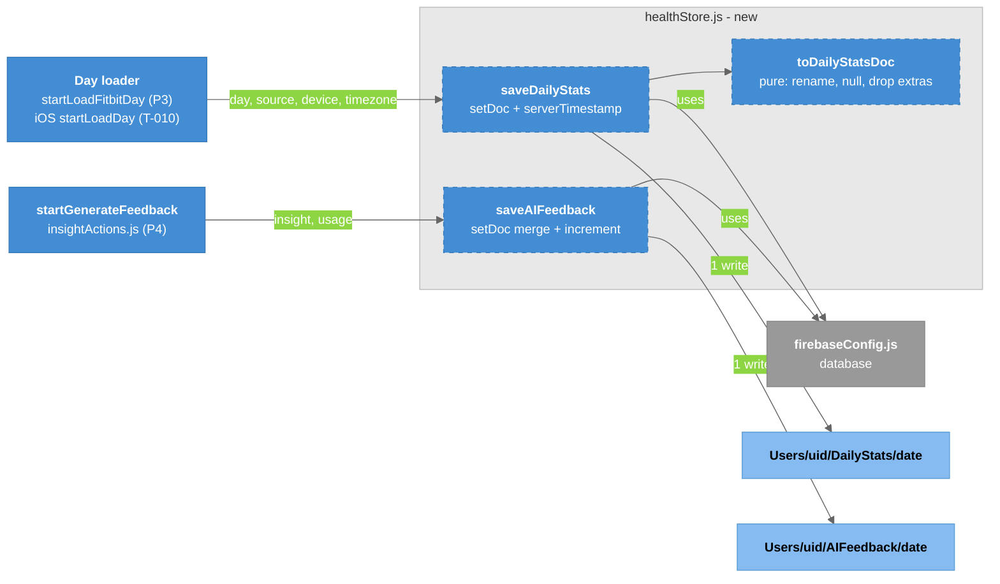

# T-009-P2: Phase 2 - App: the save module

Phase 2 of [[T-009_Save_Daily_Stats_To_Firestore]]. This adds the only code that writes `DailyStats` and `AIFeedback`, with unit tests. Nothing calls it yet (P3 and P4 wire it up).

## Summary

`SmartClothingApp/src/services/healthStore.js` maps the service's day object onto the [[Firestore_Health_Schema]] document and writes it with `setDoc`. The mapping is a pure function, so it can be tested without Firestore, and iOS ([[T-010_iOS_Apple_Watch_AI_Feedback_PoC]]) calls the same functions with `source: "healthkit"`.

## Scope

- `src/services/healthStore.js` (new):
  - `toDailyStatsDoc(day, { source, device, timezone })` is pure. It:
    - renames `logId` -> `id`, and `sleep.levels` -> `sleep.stages` (`dateTime` -> `start`)
    - copies `heart.hr5min` and `vo2Max` from P1 unchanged
    - turns `undefined` into `null`
    - drops anything that isn't in the field table
    - adds `date` and `schemaVersion: 1`
  - `saveDailyStats(uid, day, meta)` calls `setDoc(doc(database, "Users", uid, "DailyStats", date), docData)` with `syncedAt: serverTimestamp()`.
  - `saveAIFeedback(uid, date, insight, usage, meta)` calls `setDoc` with `merge: true`. It sets `regeneratedCount: 0` on the first generate and `increment(1)` on Regenerate, and `createdAt: serverTimestamp()`.
  - It uses `database` from `firebaseConfig.js`, the same way `src/actions/userActions.js` does.
- Unit tests with Firestore mocked, as in the existing action tests.

## Checklist

- [x] `toDailyStatsDoc`, `saveDailyStats`, `saveAIFeedback` in `src/services/healthStore.js`
- [x] Unit tests: nulls not zeros, `levels` -> `stages` rename, `logId` -> `id`, unknown fields dropped, `hr5min`/`vo2Max` kept, `merge` + `increment` for Regenerate
- [x] `npm test` green in `SmartClothingApp/` (32 suites, 290 tests)
- [x] Write-up

## Lead checks

- `npm test` passes in `SmartClothingApp/`.
- The mapped document in the tests matches the field table in [[Firestore_Health_Schema]].
- Nothing appears in Firebase yet.

## Diagrams

### Component - healthStore.js

### Legend

- **Blue** = existing app code that will call the module (in P3 and P4)
- **Blue dashed** = the new module's functions (this phase)
- **Gray** = the existing Firebase config
- **Light blue** = the Firestore documents
- **Light gray box** = the new module

## Files changed

| File | Change |
|------|--------|
| `SmartClothingApp/src/services/healthStore.js` | added: `SCHEMA_VERSION`, `toDailyStatsDoc`, `saveDailyStats`, `saveAIFeedback` |
| `SmartClothingApp/__test__/__unit-test__/__services-test__/healthStore.unit.test.js` | added (11 tests) |

Commits on `feature/health-schema` (pushed 2026-10-25): `5a7248d` (module), `386af99` (tests).

## Endpoints / interfaces

- `toDailyStatsDoc(day, { source, device, timezone })` returns the `DailyStats` document without `syncedAt`. Pure.
- `saveDailyStats(uid, day, meta)`: `setDoc` (no merge) on `Users/{uid}/DailyStats/{day.date}` with `syncedAt: serverTimestamp()`. A failed write rejects; the caller (P3) decides to only log it.
- `saveAIFeedback(uid, date, insight, usage, { dataSource, regenerate })`: `setDoc` with `merge: true` on `Users/{uid}/AIFeedback/{date}`. `regeneratedCount` is `0`, or `increment(1)` when `regenerate` is true. `usage` is the service's `{ model, inputTokens, outputTokens }`; missing values are `null`.

## Tests

| Test file | What it covers |
|-----------|----------------|
| `__test__/__unit-test__/__services-test__/healthStore.unit.test.js` (11) | Fitbit day mapped onto the document; `levels` -> `stages` with `start`; `logId` -> `id`; a day already in the stored shape (Health Connect / HealthKit) passes through; missing values are `null`; fields outside the schema dropped; write path and `syncedAt`; a failed write rejects; feedback document with model and tokens; `merge` + `increment(1)` on Regenerate; missing `usage` gives `null`s |

`npm test` in `SmartClothingApp/` (2026-10-25): **32 suites, 290 tests passed.** `PixelWatchScreens.test.js` prints act() and "torn down" warnings from animation timers; it failed once in an earlier full run and passed alone (28/28) and in the next full run.

## Manual verification

None needed: nothing calls the module yet, so nothing is written to Firebase. The lead ran the tests and pushed.

## Deviations from the plan

- The renames happen **only when the Fitbit names are present**. A day that already uses `stages` / `start` / `id` passes through unchanged, so `healthConnectDay.js` ([[T-001_Android_Health_Connect]]) and `healthKitDay.js` ([[T-010_iOS_Apple_Watch_AI_Feedback_PoC]]) can build the stored shape directly. Decided after the lead asked whether Health Connect changes the save: it doesn't; only the day builder and `source` change.
- `saveAIFeedback` takes `{ dataSource, regenerate }` as its last argument instead of a generic `meta`.

## Follow-ups

- P3: call `saveDailyStats` after a successful load in `startLoadFitbitDay`, skip today, only log a failed write.
- P4: call `saveAIFeedback` after `setCachedFeedback`, with `regenerate: true` from Regenerate.

## Related Notes

- [[T-009_Save_Daily_Stats_To_Firestore]]
- [[T-009-P1_Service_HR5min_VO2Max]]
- [[T-009-P3_Save_The_Day]]
- [[T-009-P4_Save_The_Feedback]]
- [[Firestore_Health_Schema]]
