# T-009-P3: Phase 3 - Save the day when it loads

Phase 3 of [[T-009_Save_Daily_Stats_To_Firestore]]. This is the first phase that writes to Firestore.

## Summary

Opening a finished day on DailySummary saves it to `Users/{uid}/DailyStats/{date}` through `saveDailyStats` (P2). Today is never saved, and a failed write never breaks the screen.

## Scope

- In the source-agnostic day loader (`startLoadFitbitDay` in `src/actions/deviceActions.js`; T-010's `startLoadDay` on iOS), call `saveDailyStats` after a successful load:
  - `source: "fitbit"`
  - `device`, if known
  - `timezone` from `Intl.DateTimeFormat().resolvedOptions().timeZone`
- Skip today (the local date).
- A failed write is logged; DailySummary still shows the day.

## Checklist

- [x] `startLoadFitbitDay` saves after a successful load; today skipped
- [x] Failed write only logs + test
- [x] `npm test` green in `SmartClothingApp/`
- [x] Lead: yesterday's `DailyStats` doc in the console; no doc for today
- [x] Write-up

## Lead checks

- Open yesterday on the phone. `Users/{uid}/DailyStats/{date}` appears in the Firebase console with every field in the table, and nulls (not zeros) for missing values.
- Open today: no document is created.

## Diagrams

### Dynamic - Save on day load

```mermaid
%%{init: {'theme': 'base', 'flowchart': {'useMaxWidth': true}, 'themeVariables': {'primaryColor': '#438DD5', 'primaryTextColor': '#fff', 'lineColor': '#666', 'fontSize': '14px'}}}%%
sequenceDiagram
    actor Athlete
    participant DS as DailySummary
    participant L as startLoadFitbitDay
    participant S as insights-service
    participant H as healthStore.saveDailyStats
    participant FS as Firestore DailyStats/date

    rect rgb(40, 85, 140)
        Athlete->>DS: open yesterday
        DS->>L: load day
        L->>S: GET /api/fitbit/day/date
        S-->>L: day (with hr5min, vo2Max)
        L-->>DS: day in Redux, screen renders
    end
    rect rgb(46, 110, 70)
        L->>L: date is not today?
        L->>H: saveDailyStats(uid, day, source, device, timezone)
        H->>FS: setDoc (overwrites, id = date)
    end
    rect rgb(95, 95, 95)
        FS-->>H: write fails (offline, rules)
        H-->>L: error is logged only, the screen is unaffected
    end
```

### Legend

- **Blue block** = the existing day load, unchanged
- **Green block** = the new save, only for finished days
- **Gray block** = a failed write is logged and never reaches the screen

## Files changed

| File | Change |
|------|--------|
| `SmartClothingApp/src/actions/deviceActions.js` | `loadFitbitEntry` takes an optional `saved` hook that runs after a successful load (not after a failed one). New `saveFinishedDay(date, day)`: skips today and future dates (`date >= toLocalDateString()`) and calls `saveDailyStats(uid, day, { source: "fitbit", device: null, timezone })` with the phone's IANA zone. Its own try/catch logs `DailyStats save error:`, so a failed write never dispatches `FITBIT_DAY_ERROR`. Only `startLoadFitbitDay` passes the hook; week, workout and month loads are unchanged |
| `__test__/__unit-test__/__actions-test__/deviceActions.unit.test.js` | Mocks `healthStore`; 5 new tests under "saving to Firestore" (fake timers pin today to 2026-10-11) |
| `__test__/__integration-test__/.../PixelWatchScreens.test.js` | Mocks `healthStore`. The screen test loads a past day, so the real save ran against the test's partial Firestore mock and logged `serverTimestamp is not a function` (swallowed, as designed, but noisy) |

Behavior that comes from the existing loader: a day already in Redux isn't fetched again, so it isn't saved again. Pull-to-refresh (`force`) saves again and overwrites the same document (one write). HomeScreen loads today, which is skipped.

## Tests

`npm test` in `SmartClothingApp/`: **32 suites, 295 tests, all passing** (290 before P3). The new tests:
- saves a finished day after it loads (`source: "fitbit"`, `device: null`, a timezone string)
- never saves today
- still shows the day when the write fails (actions are only LOADING + LOADED; the error is logged)
- does not save a day that failed to load
- does not save again a day that is already loaded

## Manual verification

Done by the lead on 2026-10-25 on the Samsung phone (Expo Go over USB, `adb reverse` + `--localhost`):
- Opened 2026-10-24 on DailySummary: `Users/{uid}/DailyStats/2026-10-24` appeared in the Firebase console with the full field set.
- Opened 2026-10-25 (today): no `2026-10-25` document.
- Pull-to-refresh on 2026-10-24: the same document was overwritten. Only `syncedAt` changed, since a finished day's data is the same on every fetch. No second document.
- No `DailyStats save error:` in the Metro log.

## Deviations from the plan

- `device` is `null`. The service's day endpoint doesn't return the watch model, and getting it needs Fitbit's `/devices.json`, which is out of scope here.
- The screen integration test needed a `healthStore` mock (not in the plan).

## Follow-ups

- Fill in `device` (Fitbit `/devices.json`, or from Health Connect in T-001).
- Nights with the watch off part of the time (2026-10-25: watch put on at 06:30) are saved as a short night. The feedback side is handled in [[T-016_Watch_Wear_Check_Before_Feedback]].
- The Expo tunnel gives "Failed to construct manifest" because the manifest comes back unsigned (probably the EAS `projectId` and the logged-in account). Use USB for now.

## Related Notes

- [[T-009_Save_Daily_Stats_To_Firestore]]
- [[T-009-P2_App_Save_Module]]
- [[T-009-P5_Daily_Auto_Save]]
- [[Firestore_Health_Schema]]
