# T-009-P4: Phase 4 - Save the feedback

Phase 4 of [[T-009_Save_Daily_Stats_To_Firestore]].

## Summary

A successful **Get feedback** or **Regenerate** writes `Users/{uid}/AIFeedback/{date}` with Claude's reply, the model that answered and the token counts. Regenerate overwrites the document and increments `regeneratedCount`.

## Scope

- In `startGenerateFeedback` (`src/actions/insightActions.js`), keep the `usage` the service returns (it's dropped today), and call `saveAIFeedback` right after `setCachedFeedback`.
- There's no write for `NO_DATA`, for errors or for cache hits. A failed write never breaks the feedback card.

## Checklist

- [x] `usage` kept; `saveAIFeedback` after `setCachedFeedback`
- [x] No write for `NO_DATA`, errors, cache hits + tests
- [x] `npm test` green in `SmartClothingApp/` (32 suites, 302 tests)
- [x] Lead: `AIFeedback` doc with model and tokens; Regenerate bumps `regeneratedCount` (2026-10-26)
- [x] Write-up

## Lead checks

- Tap **Get feedback**. `AIFeedback/{date}` has the headline, signals, focus, model and tokens.
- Tap **Regenerate**. `regeneratedCount` is 1 and the text changed.

## Diagrams

### Dynamic - Save after feedback

```mermaid
%%{init: {'theme': 'base', 'flowchart': {'useMaxWidth': true}, 'themeVariables': {'primaryColor': '#438DD5', 'primaryTextColor': '#fff', 'lineColor': '#666', 'fontSize': '14px'}}}%%
sequenceDiagram
    actor Athlete
    participant C as FeedbackCard
    participant G as startGenerateFeedback
    participant S as insights-service
    participant AS as AsyncStorage cache
    participant H as healthStore.saveAIFeedback
    participant FS as Firestore AIFeedback/date

    rect rgb(95, 95, 95)
        Athlete->>C: Get feedback
        G->>AS: cached for this date?
        AS-->>G: hit: show it, no service call, no write
    end
    rect rgb(40, 85, 140)
        G->>S: POST /api/insights/generate
        S-->>G: insight and usage (model, tokens), or NO_DATA
        G->>AS: setCachedFeedback (only for an insight)
        G-->>C: show the insight
    end
    rect rgb(46, 110, 70)
        G->>H: saveAIFeedback(uid, date, insight, usage, regenerate?)
        H->>FS: setDoc merge, regeneratedCount 0 or increment(1)
    end
```

### Legend

- **Gray block** = a cache hit: the feedback shows and nothing is written
- **Blue block** = the existing generate flow; `usage` is now kept
- **Green block** = the new write, only after a real insight (not `NO_DATA` and not an error)

## Files changed

| File | Change |
|------|--------|
| `SmartClothingApp/src/actions/insightActions.js` | New private `saveFeedback(date, insight, usage, regenerate)`, the same pattern as `saveFinishedDay` in P3: it reads `auth.currentUser?.uid` (no user means no write) and calls `saveAIFeedback(uid, date, insight, usage, { dataSource: "fitbit", regenerate })` inside its own try/catch, which only logs `AIFeedback save error:`. `startGenerateFeedback` calls it right after `setCachedFeedback`, passing the service's `usage` (dropped until now) and `force` as `regenerate` (`force` is only `true` from Regenerate). The return value is still `{ insight }`, so `AIFeedbackSection` is unchanged. Cache hits, `NO_DATA` and errors return before the save |
| `__test__/__unit-test__/__actions-test__/insightActions.unit.test.js` | Mocks `healthStore`; `auth.currentUser` reset in `beforeEach`; 7 new tests under "startGenerateFeedback saving to Firestore" |

No service change: `POST /api/insights/generate` already returned `usage: { model, inputTokens, outputTokens }`.

## Tests

`npm test` in `SmartClothingApp/`: **32 suites, 302 tests, all passing** (295 before P4). The new tests:
- saves the feedback with the model and token counts (`dataSource: "fitbit"`, `regenerate: false`)
- counts a forced generate as a regenerate (`regenerate: true`)
- writes nothing when the phone cache answers
- writes nothing for `NO_DATA`
- writes nothing when the service fails
- still returns the insight when the write fails (the error is logged)
- writes nothing without a signed-in user

## Manual verification

Done by the lead on 2026-10-26 on the Samsung phone (Expo Go), for 2026-10-25 (a day with a logged walk and no cached feedback):
- **Get feedback:** `Users/{uid}/AIFeedback/2026-10-25` appeared with `date`, `schemaVersion`, `headline`, `keySignals`, `focus`, `dataSource: "fitbit"`, `createdAt`, `regeneratedCount: 0`, `model: "claude-opus-5-5"`, `inputTokens: 1970`, `outputTokens: 115`.
- **Regenerate:** `regeneratedCount` went to 1, `createdAt` moved, `outputTokens` was 110 (input unchanged at 1970). The headline and text stayed the same.

## Deviations from the plan

- **Regenerate didn't change the text.** The lead check expected new text. The day data was identical and the coach runs at low effort, so Claude gave the same answer. The changed `outputTokens` and newer `createdAt` show it was a real second call that overwrote the document.
- **First attempts failed with a 503 that had nothing to do with P4.** The service was running under `npm run dev` (`node --watch`), and its server process was replaced in the same second the generate request arrived. The request died, ngrok returned 503 and nothing was logged. Restarting with `npm start` fixed it. A replay of the phone's real request (real profile and full day, including `hr5min`) through the coach code had worked in about 4 s, which ruled out the app, the API key and the prompt.

## Follow-ups

- Find out what makes `node --watch` restart the service during `/api/insights/generate` (a lazy `require` of the Anthropic SDK alone does not, and the service writes no files during a request). Until then, test AI feedback with `npm start`.
- A non-forced generate writes `regeneratedCount: 0` with merge, so if the phone cache is cleared and the day is generated again, the count resets. Acceptable for the PoC.
- Feedback for **today** is saved too (only `DailyStats` skips today); a Regenerate later in the day overwrites it with the fuller day.
- The app logs the full Firebase user object (including tokens) at boot (`isLoggedIn user:` in Metro). Not from this ticket; worth removing before logs are shared.

## Related Notes

- [[T-009_Save_Daily_Stats_To_Firestore]]
- [[T-009-P2_App_Save_Module]]
- [[T-003_AI_Feedback_PoC]]
- [[Firestore_Health_Schema]]
