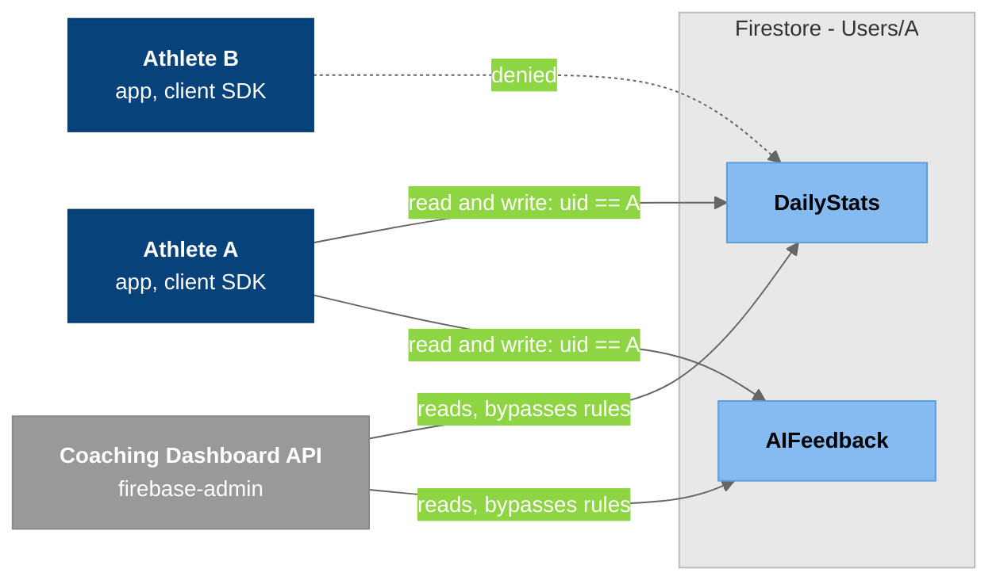

# T-009-P6: Phase 6 - Security rules

Phase 6 of [[T-009_Save_Daily_Stats_To_Firestore]]. This is the riskiest phase: the catch-all rule has to be narrowed without locking out existing screens.

## Summary

Today any signed-in user can read and write any document ([[Firestore_Rules]]). This phase makes `DailyStats` and `AIFeedback` owner-only and narrows the catch-all rule at the same time. The proper fix is the dashboard team's SEC-2; this is the interim rule.

## Scope

- `DailyStats` and `AIFeedback`: read and write only if `request.auth.uid == uid`.
- The dashboard reads them through its API with `firebase-admin`, which bypasses the rules.
- Narrow the catch-all `match /{document=**}` at the same time (Firestore ORs rules, so the catch-all would otherwise still allow everything).
- Agree on it with the dashboard team before deploying.
- Add a `CoachInsights` rule for Haley's T-014 collection (`Users/{athleteUid}/CoachInsights/{windowEnd}`). A coach can read it if the coach's `authorizedAthletes` includes the athlete. There are no client writes, because the dashboard server writes it with `firebase-admin`. With this rule in P6, T-014 has no rules work.

### Found on 2026-10-26, before starting

- **Two rules files for one Firebase project.**
  - `SmartClothingApp/firestore.rules` (this repo) is the live, deployed one.
  - `coaching-dashboard/firestore.rules` is a stale copy. It still has the open `request.auth != null` catch-all, plus a dead one dated 2025-08-24. Deploying it would undo this phase.
  - P6 adds a "don't deploy, see SmartClothingApp/firestore.rules" comment to the dashboard copy, or deletes it. Agree on which with the dashboard team.
- **The dashboard browser uses the Web SDK, so these rules apply to it.** P6 has to keep these working:
  - Coaches adding themselves to `Users/{athleteUid}.pendingPermissions`
  - Creating `Invitations`
  - Any `Users` reads

  Confirm each one in `coaching-dashboard/src` before narrowing the catch-all.

### Found on 2026-10-26, planning chat

**The dashboard's browser calls on `origin/main` (`7cde460`).** The rules apply to all of these:

| File | Call | What it needs |
|---|---|---|
| `Login.jsx`, `ProtectedRoute.jsx`, `Navbar.jsx` | `getDoc(Users/{ownUid})` | read own user doc |
| `Register.jsx` | `setDoc(Users/{ownUid})` | create own user doc |
| `sendInvitation.js` | `getDocs(Users where email == x)` | read other users' docs (athlete lookup by email) |
| `sendInvitation.js` | `addDoc(Invitations)`, `updateDoc(own doc, invitationsSent)` | create an invitation, write own doc |
| `sendInvitation.js` | `updateDoc(Users/{athlete}, pendingPermissions: arrayUnion)` | write one field of another user's doc |
| `fetchPendingInvitations.js` | `Invitations where coachId == me` | read own invitations |

- No browser code reads subcollections.

**Carlos's `dashboard-dev-data-switch` takes the browser off Firestore.**
- Carlos says it's the up-to-date branch. It goes to `main` next, and `dashboard-backend-modules` gets deleted.
- `src/` no longer imports `firebase/firestore`; `server/tests/no-browser-firestore.test.cjs` enforces that. Every data call goes through the API with `firebase-admin`.
- Once it's on `main`, the rules only matter for the athlete app.
- The API's login check is Devon's work: `server/security/provider.js` and `src/security/backendTransport.js` are placeholders until then. **P6 doesn't depend on Devon.** The rules guard direct Firestore access; Devon guards the API.

**The app also writes other users' docs.**
- Accepting a coach (`NotificationPermissionsModal`, `PermissionsModal`) does `updateDoc(Users/{coach}, authorizedAthletes: arrayUnion(me))`.
- `fetchPendingPermissions` and `fetchCoachAccess` read coach docs to show their names.

**Removing a coach doesn't clear `authorizedAthletes`.**
- `deleteFromCoachAccess` (`SmartClothingApp/src/actions/userActions.js:846`) only removes the coach from the athlete's `coachList`. The athlete stays in the coach's `authorizedAthletes`.
- Carlos's roster (`listUsers` in `server/integrations/firebase/users.js`) reads `authorizedAthletes`, so removed athletes still show.
- Coach access should be judged by the athlete's `coachList`, which only the athlete can write under the rules below. Tell Devon, so his coach-to-athlete check uses it.

**The stale dashboard rules file can't be deployed by accident.** The dashboard has no `firebase.json`, so `firebase deploy` from that repo has no rules target. It's still misleading.

### Proposed rules (not deployed)

```
function signedIn() { return request.auth != null; }
function isOwner(uid) { return signedIn() && request.auth.uid == uid; }

match /Users/{uid} {
  allow read: if signedIn();
  allow create, delete: if isOwner(uid);
  allow update: if isOwner(uid)
    || (signedIn() && request.resource.data.diff(resource.data)
          .affectedKeys().hasOnly(['pendingPermissions', 'authorizedAthletes']));

  match /CoachInsights/{windowEnd} {
    allow read: if isOwner(uid) || (signedIn() &&
      /databases/$(database)/documents/Users/$(request.auth.uid) in
        get(/databases/$(database)/documents/Users/$(uid)).data.get('coachList', []));
    allow write: if false;
  }
  match /{sub}/{docId=**} {
    allow read, write: if isOwner(uid) && sub != 'CoachInsights';
  }
}

match /Invitations/{id} {
  allow read, write: if signedIn();
}
```

- **`Users` read** stays open to any signed-in user, because `main`'s email lookup needs it. It can close once Carlos's branch is on `main`.
- **Other users' writes on `Users`** are limited to the two consent fields. That keeps both invite flows working, and nobody can overwrite another user's profile, metrics or push token.
- **`sub != 'CoachInsights'`** is needed because Firestore ORs matching rules. Without it, the owner wildcard would let the athlete write `CoachInsights`.
- **No catch-all**, so anything not listed is denied.

### Still open before deploying

- **Carlos:** does anything else write to Firestore directly (Galaxy watch, Health Connect, old scripts)? The lead can also check the console's top-level collections.
- **Carlos:** add a "don't deploy" header to `coaching-dashboard/firestore.rules`, or delete it?
- **Devon** (the lead reaches out): coach access = coach ref in the athlete's `coachList`.

## Checklist

- [ ] Owner-only rules for `DailyStats` and `AIFeedback`; catch-all narrowed
- [ ] Agreed with the dashboard team
- [ ] Lead: Rules Playground check; existing screens still load
- [ ] Write-up

## Lead checks

- In the Rules Playground or the emulator, athlete A can't read athlete B's `DailyStats`.
- The existing app and dashboard screens still load.

## Diagrams

### Who can read and write what



### Legend

- **Dark blue** = athletes using the app (the client SDK, subject to the rules)
- **Gray** = the dashboard's server, which uses the Admin SDK and isn't subject to the rules
- **Light blue** = athlete A's two collections
- **Solid arrow** = allowed; **dashed arrow** = denied by the new rule

## Files changed

*Filled in when the phase is done.*

## Manual verification

*Filled in when the phase is done.*

## Deviations from the plan

*Filled in when the phase is done.*

## Follow-ups

- **The dashboard API routes are open (not P6 scope; rules can't fix it).**
  - Routes like `/api/heart-rate?userId=` and `/api/sleep` in `coaching-dashboard/server/server.js` never check the caller's Firebase ID token.
  - Anyone who can reach the server can read any athlete's data, because the server uses `firebase-admin`, which bypasses the rules.
  - Henry's [[T-017_Coach_Athlete_Info_Real_Data_And_AI_Card]] route must check the token and the coach's access.
  - The existing routes need their own ticket.

## Related Notes

- [[T-009_Save_Daily_Stats_To_Firestore]]
- [[Firestore_Rules]]
- [[Firestore_Health_Schema]]
