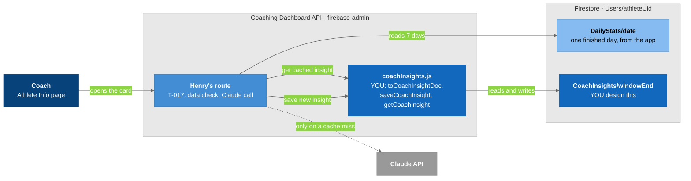

# T-014: Coaching Dashboard: design and code the CoachInsights schema

## User story

> A coach opens an athlete's Athlete Info page and sees an **AI-Powered Insights** card: a performance summary, key insights, and what needs attention. The card is built from the athlete's last 7 days. When the coach comes back an hour later, the same insight loads instantly from Firestore instead of paying for a new Claude call.

## Summary

You own the **shape of the saved insight**. That covers which document it lives in, which fields it has, what each field means, and the server code that builds, saves and reads it. Henry (T-017) builds the page, the Claude call and the card on top of your code.

**In scope:** a schema design doc, and one server module that uses `firebase-admin`.

**Not in scope:** tests, Firestore security rules, the Claude prompt and call, the card UI, and deployment (see Out of scope).

## Why

- **Cost:** every Claude call costs money, and the team pays for its own Anthropic key. Saving the answer means a coach who reopens the page pays nothing.

- **One agreed shape:** Henry's route writes this document and his card reads it. If the shape is written down first, you can both work without guessing.

- **The athlete side already works this way.** The athlete app saves each day's Claude feedback to `Users/{uid}/AIFeedback/{date}`. Your collection is the coach-side version: one insight about an athlete's **week**, for coaches.

## Depends on

**Nothing.** You can start today:
- The athlete data you design around already exists: `DailyStats` and `AIFeedback` are being saved from the athlete app.

- Your code runs on the dashboard **server** with `firebase-admin`. Firestore security rules and the API's login check (Devon's work) don't apply to it.

## How we work

- **Base branch:** `dashboard-dev-data-switch` (Carlos's up-to-date branch). Once Carlos pushes it to `main`, branch from `main` instead.

- One branch and one PR per phase, for example `feature/coach-insights-p1-schema` and `feature/coach-insights-store`.

- Matthew reviews each PR. The review is the check for this ticket. **Don't write test files or throwaway scripts**; Kam adds tests in a later ticket.

- **Never write to the real Firebase project from this ticket.** No test documents, no seed data.

## How it fits



### Legend

- **Dark blue** = the coach
- **Darker blue** = your parts: the module and the collection
- **Blue** = Henry's route (T-017)
- **Light blue** = existing athlete data
- **Gray** = external (Claude)
- **Light gray boxes** = boundaries
- **Solid arrow** = always happens; **dashed arrow** = only when there's no saved insight

---

## Phases

### Phase 0: Read the inputs (no code)

- [ ] Read **the athlete data** below ("Reference: what the athlete app saves"). This is what Henry's route sends to Claude.
- [ ] Read **the card** below ("Reference: the coach card"): its three sections and the data-quality cases.
- [ ] Read **how coach access works** ("Reference: coach access").
- [ ] Read Carlos's `server/integrations/firebase/users.js` on `dashboard-dev-data-switch`. It's the code pattern you'll copy in P2: a `create...` function that receives `{ db, FieldValue }` and returns an object of functions.
- [ ] Also skim `server/dependencies.js`, which is where those modules get registered.
- [ ] Write a list: for each card section, which fields the saved insight needs.
- **Done when:** the list is in the description of your P1 PR.

### Phase 1: Design the schema (a doc, no code)

- [ ] Create `docs/coach-insights-schema.md`. It must contain:

  - **The path.** The starting point is `Users/{athleteUid}/CoachInsights/{windowEnd}`, where `windowEnd` is the last day of the 7-day window (`YYYY-MM-DD`). Change it if you find a better one, and write down why.

  - **A field table:** name, type, whether it can be `null`, and what it means.

  - **The Claude reply fields** (the three card sections) and the **cost fields** (which model answered, input and output tokens). `AIFeedback` is the example to follow.

  - **What was checked:** which days went in, and the data-quality result. That lets Henry tell whether the cache is still valid (edge case 9).

  - **A flowchart** of one document, like the "One `AIFeedback` document" diagram in the reference.

  - **2 example documents** in JSON: one normal insight, and one blocked because only 2 of 7 days were recorded. Decide whether a blocked result is saved at all, and say why.

- **Done when:** Matthew approves the schema PR. 

### Phase 2: Code the schema

- [ ] Add `server/integrations/firebase/coachInsights.js`. It exports `createFirebaseCoachInsights({ db, FieldValue })`, which returns:

  - **`toCoachInsightDoc(input)`** builds the document from the route's values, checks the shape, and throws a clear error if a required field is missing or the wrong type. It follows the P1 doc exactly.
    - Missing values become `null`, never `0`.
    - It sets `schemaVersion` and a `createdAt` of `FieldValue.serverTimestamp()`.
    - The athlete app's `toDailyStatsDoc` does the same job for `DailyStats` (see "Reference: a doc-builder example").

  - **`saveCoachInsight(athleteUid, windowEnd, input)`** builds the doc with `toCoachInsightDoc` and writes it, overwriting any old one for the same window.

  - **`getCoachInsight(athleteUid, windowEnd)`** returns the saved doc, or `null` if there isn't one.

- [ ] Register it in `server/dependencies.js`. In the `"firestore"` branch of `forSource`, add `coachInsights: createFirebaseCoachInsights(firebase)`.

- [ ] Check every field against your P1 doc before you open the PR.

- **Done when:** the PR is open, its code matches the P1 doc, and `npm run lint` passes.

A starting point:

```js
// server/integrations/firebase/coachInsights.js
const SCHEMA_VERSION = 1;

function createFirebaseCoachInsights({ db, FieldValue }) {
  const insightRef = (athleteUid, windowEnd) =>
    db.collection("Users").doc(athleteUid).collection("CoachInsights").doc(windowEnd);

  function toCoachInsightDoc(input) {
    // Build every field from your P1 doc here, and throw on a bad shape.
    return { schemaVersion: SCHEMA_VERSION, createdAt: FieldValue.serverTimestamp() };
  }

  return {
    toCoachInsightDoc,
    async saveCoachInsight(athleteUid, windowEnd, input) {
      await insightRef(athleteUid, windowEnd).set(toCoachInsightDoc(input));
    },
    async getCoachInsight(athleteUid, windowEnd) {
      const snapshot = await insightRef(athleteUid, windowEnd).get();
      return snapshot.exists ? snapshot.data() : null;
    },
  };
}

module.exports = { createFirebaseCoachInsights };
```

### Phase 3: Hand off + weekly report

- [ ] Add a **"Claude reply format"** section to `docs/coach-insights-schema.md`: the exact JSON the coach prompt must return, so `toCoachInsightDoc` can take it as-is. Henry writes the prompt to match.

- [ ] Add a **"For Henry"** section: how to call `getCoachInsight` and `saveCoachInsight` from a route (through the `coachInsights` dependency), and what `toCoachInsightDoc` throws on.

- [ ] Send Matthew a **weekly report** (in the GitHub issue or a message):
  - What you decided, and why.
  - What you changed from this ticket's starting points.
  - What's still open.
  - What you'd do next.

- **Done when:** Henry and Matthew have the doc and the report.

---

## Decisions already made

You can change any of these if you write down why in the P1 doc.

- **Window:** the 7 days ending **yesterday**. Today is never saved by the athlete app, so it's never in the window.

- **Coach-only:** the athlete never sees this insight; the athlete app has its own feedback.

- **Server-only writes:** only the dashboard API writes it, with `firebase-admin`. No browser or app code touches it.

- **`null`, never `0`,** for anything missing.

- **No real data** written to Firebase from this ticket.

## Reference: what the athlete app saves

`Users/{uid}/DailyStats/{YYYY-MM-DD}` holds one finished day per document.

| Field | Type | Content |
|-------|------|---------|
| `date` | string | The athlete's local date, same as the id |
| `schemaVersion` | number | `1` |
| `source` | string | `"fitbit"`, `"healthkit"` or `"health_connect"` |
| `device` | string or null | Watch model, if known |
| `timezone` | string | IANA zone of the phone when saved |
| `syncedAt` | timestamp | When it was saved |
| `steps` | number or null | Day total |
| `vo2Max` | map or null | `{ low, high }` in ml/kg/min (a range, or one value where `low` = `high`) |
| `sleep` | map or null | `totalMinutes`, `efficiency`, `deep`, `light`, `rem`, `wake`, `bedTime`, `wakeTime`, `stages` |
| `heart` | map | `restingHeartRate`, `previousRestingHeartRate`, `zones { fatBurn, cardio, peak }`, `hr5min` (288 average-bpm values, one per 5 minutes from midnight, or `null`) |
| `workouts` | array | `[ { id, type, startTime, durationMin, avgHeartRate, calories, steps, distanceKm, paceMinPerKm, hasGps, zones } ]` |

`Users/{uid}/AIFeedback/{YYYY-MM-DD}` is the athlete's own feedback for one day, and **the closest example to your collection**.

| Field | Type | Content |
|-------|------|---------|
| `date` | string | Same as the id |
| `schemaVersion` | number | `1` |
| `headline` | string | The decision for the next session |
| `keySignals` | string[] | Up to 2 pieces of evidence, each with a number |
| `focus` | string[] | Up to 2 constraints for the next session |
| `model` | string | The model that actually answered |
| `inputTokens`, `outputTokens` | number | For cost: tokens × the model's price |
| `dataSource` | string | `source` of the day the feedback used |
| `regeneratedCount` | number | How many times Regenerate was tapped |
| `createdAt` | timestamp | `serverTimestamp()` |

Rules for both collections:
- Missing values are `null`, never `0`.
- Times are local ISO strings without an offset.
- No raw vendor payloads, no GPS routes.

## Reference: the coach card

The card has three parts:

1. **Performance summary:** how the athlete's week went.
2. **Key insights:** what the data shows, with numbers.
3. **Needs attention:** what the coach should look at or act on.

Before calling Claude, Henry's route checks whether the data is good enough. Cases from T-017 that affect what you store:

| Case | What happens | What it means for you |
|------|--------------|------------------------|
| No `DailyStats` in the window | Blocked, no Claude call | Do you save a "blocked" doc, or nothing? |
| Too few usable days (for example 2 of 7) | Blocked, no Claude call | The reasons shown to the coach, for example "Only 2 of the last 7 days were recorded" |
| Some days have no overnight sleep data | Warn: call Claude, but say what's missing | A place for warnings |
| Nothing changed since the last insight | Serve the saved one, no new call | Record which days and `syncedAt` values went in, so "changed" can be checked |
| VO2 max missing on most days | Allowed; VO2 max left out | Fields can be `null` |
| Mixed sources (`fitbit`, then `health_connect`) | Allowed | Maybe record the sources used |

The thresholds (minimum days, stale cutoff) are still open in T-017. Design fields that hold the result, not the thresholds themselves.

## Reference: coach access

- An athlete accepts a coach in the app, which adds the coach to the athlete's `Users/{athleteUid}.coachList`.

- The app also adds the athlete to the coach's `Users/{coachUid}.authorizedAthletes`. But when an athlete later **removes** a coach, only `coachList` changes.

- So **`coachList` is the one to trust.** Henry's route and Devon's access check handle this; your module doesn't check access. It's here so your doc doesn't describe access the wrong way.

- Matthew's Firestore rules change adds a rule for `CoachInsights`: no app or browser writes, and coach reads only. You have no rules work.

## Reference: a doc-builder example

In the athlete app (`SmartClothingApp/src/services/healthStore.js`), `toDailyStatsDoc(day, { source, device, timezone })` takes the day's values and returns exactly the fields of the schema, with missing values as `null` and `schemaVersion` set. `saveDailyStats` calls it, adds a `syncedAt` server timestamp, and writes with `setDoc`, overwriting by date. Your `toCoachInsightDoc` and `saveCoachInsight` are the server (`firebase-admin`) version of the same idea.

---

## Progress checklist

| Phase | Status | Owner | Branch / PR |
|-------|--------|-------|-------------|
| P0 Read the inputs | Not started | Haley | — |
| P1 Design the schema | Not started | Haley | — |
| P2 Code the schema | Not started | Haley | — |
| P3 Hand off + weekly report | Not started | Haley | — |

## Acceptance criteria

- [ ] `docs/coach-insights-schema.md` has the path, a field table with types and null rules, a document flowchart, and 2 example documents (one normal, one blocked).

- [ ] The doc has the Claude reply format and a "For Henry" section.

- [ ] `server/integrations/firebase/coachInsights.js` exports `createFirebaseCoachInsights({ db, FieldValue })` with `toCoachInsightDoc`, `saveCoachInsight` and `getCoachInsight`.

- [ ] `toCoachInsightDoc` produces exactly the fields in the doc, uses `null` (never `0`) for missing values, and throws a clear error on a bad shape.

- [ ] The module is registered as `coachInsights` in the Firestore branch of `server/dependencies.js`.

- [ ] `npm run lint` passes

- [ ] Nothing was written to the real Firebase project.

- [ ] Matthew has the weekly report.

## Out of scope (later tickets or other people)

- **Tests:** Kam's later ticket. `server/tests/firestore.repositories.test.cjs` shows the fake-Firestore style those tests will use.
- **Verification scripts** or throwaway files.
- **Firestore security rules:** Matthew adds the `CoachInsights` rule.
- **The API's login and coach-access check:** Devon's work.
- **The Claude prompt, the Claude call, and the route:** Henry (T-017).
- **The card UI:** Henry (T-017).
- **The team-wide summary:** T-012.
- **Deployment:** the team deploys to its own servers at the end of the semester.

## Open questions

1. If an athlete has two coaches, do they share one insight per window? The starting path assumes yes, because the insight is about the athlete, not the coach.
2. Is a blocked result saved (so the reasons load instantly), or not saved at all?
3. Should the doc keep a `regeneratedCount` like `AIFeedback`, for a future cost cap 

## Related Notes

- [[T-017_Coach_Athlete_Info_Real_Data_And_AI_Card]]
- [[Firestore_Health_Schema]]
- [[T-009_Save_Daily_Stats_To_Firestore]]
- [[T-009-P6_Security_Rules]]
- [[T-015_Dashboard_CI_Pipeline]]
- [[T-012_Team_Insights_AI_Feedback_PoC]]
