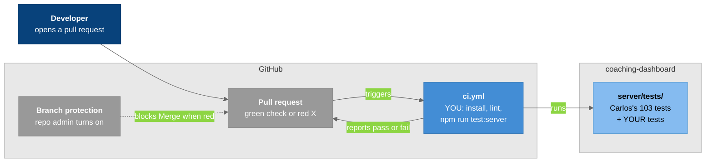

# T-015: Coaching Dashboard: first CI pipeline (GitHub Actions)

## User story

> A developer on the senior design team opens a pull request on `coaching-dashboard`. A few minutes later, GitHub shows a **green check** if the tests pass or a **red X** if something broke. Nobody can merge a red PR into `main`.

## Summary

This is a **first task in testing**, so it starts small on purpose. You'll write your first **unit test**, run it with the test setup Carlos already uses, and then make GitHub run all the server tests on every PR. Each phase ends with something you can see: a passing test, then a failing test, then a green check on GitHub.

**In scope:** CI, and server unit tests with **Node's built-in test runner** (`node:test`).

**Not in scope:** no live Firebase, no emulator, no network calls, no frontend tests, and no deployment (see Out of scope).

## Why

- **What a test is:** code that runs your code with a known input and checks the output. It says *pass* or *fail*.
- **What CI is:** short for Continuous Integration. It's a robot (GitHub Actions) that runs the tests on a fresh machine for every PR. If they fail, the PR shows red, so broken code doesn't reach `main`.
- **Why it matters here:**
  - `coaching-dashboard` has **no CI at all**: there's no `.github/workflows/` folder.
  - The team rule "lint and tests pass before merging" is only on the honor system.
  - Several people are about to work in the same repo (Haley's T-014, Henry's T-017 and more), and CI is what keeps that safe.

### Why we follow Carlos's test setup

Carlos's branch (`dashboard-dev-data-switch`, PR #52) already has **103 server tests** in `server/tests/`. They use Node's built-in test runner (`node:test` and `node:assert/strict`), so no extra test library is needed.

- **They run with no Firebase credentials** and no network: the tests build the API with fake data sources. All 103 passed in a run on 2026-10-26.
- So **CI can run real tests from day one**, not only yours.
- **Your tests use the same style**, so the whole server has one way of testing.

### Why not the old frontend tests

`src/__tests__/` has two old frontend test files (run with Vitest), but they can't run in CI and some of them can't fail:

| File | What it does | Problem |
|------|--------------|---------|
| `login.test.jsx` | 1 test renders the Login page. 3 tests sign in to the **live** Firebase project with an email and password written in the file | The 2 "wrong password" tests catch the error and only `console.log`, so **they always pass**. A real password is in the repo |
| `routes.test.jsx` | Signs in with a hard-coded account and copies the role → page `switch` into the test | That account no longer works. The test swallows the error and **always passes** |

A GitHub runner has no `.env.local` and no Firebase login. **A test that can't fail isn't a test.** Fixing these is a good *second* ticket (see Out of scope).

## Depends on

**Nothing.** You can start today.

## How we work

- **Base branch:** `dashboard-dev-data-switch` (Carlos's PR #52). Once PR #52 merges to `main`, branch from `main` instead.
- One branch and one PR per phase: `feature/ci-p1-first-test`, `feature/ci-p2-workflow`, and so on.
- Zach (tech lead) or Matthew reviews each PR. Hannah tracks this checklist.
- Questions go in the GitHub issue or the group chat, in writing.

## How it fits



### Legend

- **Dark blue** = the developer
- **Blue** = your part: the workflow
- **Light blue** = the tests it runs (Carlos's and yours)
- **Gray** = GitHub features
- **Light gray boxes** = boundaries
- **Solid arrow** = happens on every PR; **dashed arrow** = only once branch protection is on (P4)

---

## Phases

### Phase 0: Learn the loop (no code)

- [ ] Clone the repo, switch to `dashboard-dev-data-switch`, and run `npm ci`.
- [ ] Run Carlos's tests: `node --test "server/tests/*.test.*"`. You should see `tests 103`, `pass 103`, `fail 0`. A few "Platform metric reads are not integrated yet" lines are expected; those tests check an error on purpose.
- [ ] Open one small test file, for example `server/tests/dateRangeCache.test.mjs`, and read a few tests. Each one is a `test("what it checks", () => { ... })` with `assert` lines inside.
- [ ] Read the Node test runner docs (nodejs.org/api/test.html, the first sections) and GitHub's "Understanding GitHub Actions" page (docs.github.com/actions).
- [ ] In the PR description for P1, write two sentences in your own words: what a unit test is, and what CI does.
- **Done when:** you can run the 103 tests and explain both.

The smallest possible unit test, to read before P1:

```js
const { test } = require("node:test");
const assert = require("node:assert/strict");

function add(a, b) {
  return a + b;
}

test("adds two numbers", () => {
  assert.equal(add(2, 3), 5); // passes; change 5 to 6 and watch it fail
});
```

### Phase 1: Your first unit test

- [ ] Add `server/tests/validation.test.cjs` with tests for `id()` from `server/http/validation.js`.
  - `id()` checks a user id before any route uses it. It returns the id when it's valid, and throws a `400` error when it isn't (empty, spaces around it, a `/` in it, longer than 128 characters, or `.` / `..`).
  - It's a perfect first target: a plain function, input in, answer out, nothing to fake.
  - It protects real code: every route calls it, including Henry's new ones.
- [ ] Write at least: one valid id, an empty string, an id with a `/`, an id with spaces around it, and one that's too long.
- [ ] **Break it on purpose.** In `validation.js`, change the length limit from `128` to `5`. Run your tests, and watch the valid-id test fail (`"athlete123"` is now "too long") and read the error message, then undo the change.
- [ ] Add a script to `package.json`: `"test:server": "node --test \"server/tests/*.test.*\""`. This runs Carlos's tests and yours with one command.
- **Done when:** `npm run test:server` passes (`103` + your tests), and you've seen your test fail once.

A starting point:

```js
// server/tests/validation.test.cjs
const { test } = require("node:test");
const assert = require("node:assert/strict");
const { id } = require("../http/validation");

test("id returns a valid id unchanged", () => {
  assert.equal(id("athlete123"), "athlete123");
});

test("id rejects an empty string with a 400", () => {
  assert.throws(() => id(""), (error) => error.status === 400);
});
```

- `assert.equal(actual, expected)` checks that two values match.
- `assert.throws(fn, check)` checks that `fn` throws, and that the error passes `check`. Look at `server/http/errors.js` to see what the error object holds.

### Phase 2: Your first CI workflow

- [ ] Add `.github/workflows/ci.yml`:
  - Triggers: `pull_request`, and `push` to `main`.
  - Runner: `ubuntu-latest`.
  - Steps: `actions/checkout@v4`, then `actions/setup-node@v4` with **Node 22** and `cache: npm`, then `npm ci`, then `npm run test:server`.
  - **Use Node 22 or newer.** The `"server/tests/*.test.*"` pattern in `test:server` needs it; Node 20 doesn't understand it.
- [ ] Put a comment above every step saying what it does, in your own words.
- [ ] Open the PR and watch the **Actions** tab. The check goes green.
- [ ] Push a commit that breaks your test, watch the check go **red**, take a screenshot, then revert.
- **Done when:** the PR has a green check, and the red screenshot is in the PR description.

### Phase 3: Grow it a little

- [ ] Run `npm run lint` locally first.
  - If it passes, add it as a CI step **before** the tests.
  - If it fails on code you didn't write, don't fix other people's code in this ticket. Write down the errors in the PR, and ask Matthew whether to add lint now or after the team fixes them.
- [ ] Write 1-2 more small tests for plain functions: for example `string()` in `server/http/validation.js`, or `readConfig()` in `server/config/index.js`. `readConfig()` takes the settings as an argument, so you can pass fake ones.
- [ ] Add a short "Running tests" section to `README.md` (the commands, and what CI checks), plus the Actions status badge.
- **Done when:** CI runs lint (or the PR explains why not yet) and all the server tests, and it's green.

### Phase 4: Make it the rule

- [ ] The **repo admin** turns on **branch protection** for `main`: the CI check must pass before merging. Matthew has write access but isn't an admin, so Matthew asks the admin after your first green run. Kam watches and writes down the steps.
- [ ] Prove it: open a test PR with a failing test and check that the Merge button is blocked.
- [ ] Write `T-015-P4_CI_Write_Up.md`: what you built, what you learned, and what you'd test next.
- **Done when:** a red PR can't merge into `main`.

---

## Progress checklist

| Phase | Status | Owner | Branch / PR |
|-------|--------|-------|-------------|
| P0 Learn the loop | Not started | Kam | — |
| P1 First unit test | Not started | Kam | — |
| P2 First CI workflow | Not started | Kam | — |
| P3 Grow it a little | Not started | Kam | — |
| P4 Make it the rule | Not started | Kam + repo admin | — |

## Acceptance criteria

- [ ] `server/tests/validation.test.cjs` tests `id()` with valid and invalid ids, and it fails when `id()` is broken.
- [ ] `npm run test:server` runs every test in `server/tests/` (Carlos's and the new ones).
- [ ] `.github/workflows/ci.yml` runs on every PR and on pushes to `main`, on Node 22, and needs **no secrets**.
- [ ] Lint runs in CI, or the PR explains why it's not added yet.
- [ ] No test makes a network call or needs Firebase.
- [ ] Branch protection on `main` requires the CI check.
- [ ] The README explains how to run the tests and what CI checks.

## Out of scope (later tickets)

- **Tests for Haley's `coachInsights` module (T-014) and Henry's data-quality check (T-017).** These are the natural next tests once their PRs merge. Henry's check is a pure function with one case per edge case, so it's a good fit.
- Rewriting the old frontend tests (`login.test.jsx`, `routes.test.jsx`) without live Firebase, and removing the hard-coded password.
- `npm run build` in CI.
- Firestore rules tests on the emulator.
- Calling a running server from CI.
- Deployment (CD). The team deploys to its own servers at the end of the semester.

## Open questions

1. Should CI also run on pushes to other long-lived branches, or only PRs and `main`?
2. When the old frontend tests are fixed, should CI also run `npm test` (Vitest)?

## Related Notes

- [[T-015_Standup_Brief_Kam_CI]]
- [[T-014_Coach_AI_Insights_Schema]]
- [[T-017_Coach_Athlete_Info_Real_Data_And_AI_Card]]
