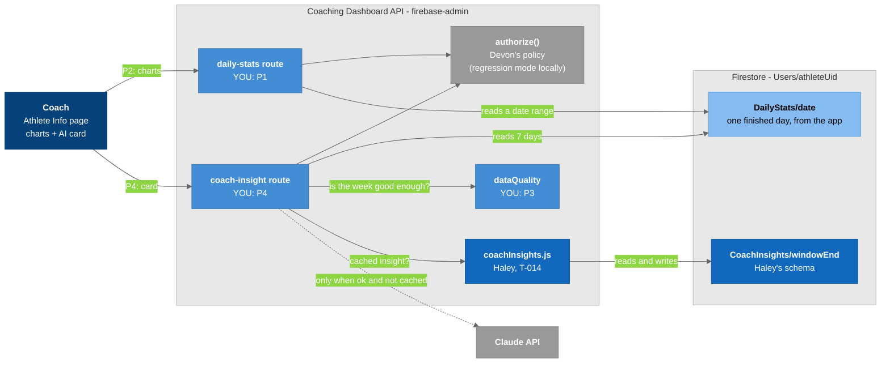

# T-017: Athlete Info on real data, with a coach AI card that knows when not to run

## User story

> A coach opens an athlete's Athlete Info page and sees that athlete's real week: heart rate, VO2 max, sleep and workouts. Below it, an **AI-Powered Insights** card gives a performance summary, key insights, and what needs attention. When the athlete didn't wear the watch enough, the card says so in plain words instead of guessing, and no Claude call is made.

## Summary

The coach's Athlete Info page (`/info`, `src/pages/AthleteInfo.jsx`) still reads the old `HeartRateDataHC`, `SleepDataHC` and `VO2MaxDataHX` collections, which hold fake or unlabelled data. This ticket:

1. adds a server route that reads the athlete's real `Users/{uid}/DailyStats/{date}` documents,
2. switches the page and its charts to that route,
3. adds a data-quality check that decides whether the week is good enough for Claude, and
4. adds the coach AI card, cached in Haley's `CoachInsights` collection (T-014).

**In scope:** server routes and providers in the dashboard API, the Athlete Info page and its chart components, the data-quality function, the coach prompt and Claude call, and the card UI.

**Not in scope:** login and coach-access checks (Devon), tests (Kam), the `CoachInsights` schema (Haley), rules, and deployment (see Out of scope).

## Why

- **Real data:** the athlete app saves one `DailyStats` doc per finished day . The field list is below in "Reference: DailyStats".

- **Cost:** every Claude call costs money. A call on partial data costs the same as a good one, but gives wrong feedback (for example "short sleep" when the watch just wasn't worn).

- **Trust:** a coach who sees one wrong insight stops trusting the card. "Not enough data for this athlete this week" is better than a guess.

- **One definition of "enough data":** the athlete app's own feedback gate will reuse the thresholds set here, so an athlete and a coach never see contradicting feedback.

## What's blocking, and what isn't

You can start **today**. Only P4 waits on someone else.

| Who / what | What it blocks | What you do |
|---|---|---|
| **Devon: API login** (`server/security/provider.js` denies everything, `src/security/backendTransport.js` throws) | Using the dashboard outside your laptop | Nothing to wait for. Develop in **local regression mode** (see P0). Every route has one `authorize(...)` line, like `server/modules/metrics/routes.js`. **Never edit `provider.js`, `backendTransport.js` or `boundary.js`**, and never read a user id from the query to decide access. |
| **Devon: which coach may see which athlete** | Edge case 1 | Not your code. Devon's policy checks the athlete's `coachList` for the `metrics.read` action. Regression mode allows everything, so you won't see a 403 locally; that's expected. |
| **Haley: T-014** (`coachInsights` module + Claude reply format) | P4 only | P1 to P3 don't need it. Talk to Haley early about the Claude reply JSON (her P3), so your prompt and her `toCoachInsightDoc` match. Start P4 after her P2 PR is merged. |
| **Carlos: `dashboard-dev-data-switch` → `main`** (PR #52, open; he has one fix to make before merging) | Nothing | Branch from `dashboard-dev-data-switch`. When PR #52 merges, rebase onto `main`. |
| **Anthropic API key** | P4 only | **You get and manage your own key.** Put it in the server `.env` as `ANTHROPIC_API_KEY`, never in the frontend, never committed. Set a spend limit on it. |

## How we work

- **Base branch:** `dashboard-dev-data-switch` (Carlos's up-to-date branch). Once Carlos merges it to `main`, branch from `main` instead.

- One branch and one PR per phase, for example `feature/athlete-daily-stats-api`, `feature/athlete-info-real-data`, `feature/athlete-data-quality`, `feature/coach-insight-card`.

- Matthew reviews each PR. The review is the check for this ticket. **Don't write test files or throwaway scripts**; Kam adds tests in a later ticket.

- **Reading** the real Firebase project is fine. **Writing** happens only in P4 (`CoachInsights` docs), and only for test athletes.

- Code comments explain the code. No ticket numbers, phase names or dates in comments.

- `npm run lint` passes on every PR.

## How it fits



### Legend

- **Dark blue** = the coach
- **Blue** = your parts (P1, P3, P4)
- **Darker blue** = Haley's module and collection (T-014)
- **Light blue** = existing athlete data
- **Gray** = someone else's or external (Devon's policy, Claude)
- **Light gray boxes** = boundaries
- **Solid arrow** = always happens; **dashed arrow** = only when the data is good enough and there's no cached insight

---

## Phases

### Phase 0: Set up and read (no code)

- [ ] Branch from `dashboard-dev-data-switch`.
- [ ] Get the dashboard's local secret files from Carlos:
  - `server/firebase-service-account-prototype.json`, the Firebase Admin key for the shared `coach-student-invite` project
  - the `.env` file(s)
  - **Don't create your own Firebase project.** The athletes' `DailyStats` live in the shared project, so a new one would be empty.
  - These files are gitignored. Never commit them or paste them in chat.
- [ ] Start the dashboard in **local regression mode**: `npm run dev:api:data-switch` in one terminal and `npm run dev` in another. In this mode the API checks your Firebase sign-in, but skips the coach-to-athlete check that Devon hasn't finished.
- [ ] **Select Firebase in the data toggle** (the Firebase/Postgres button, bottom right of the screen). The toggle picks where **health data** comes from:
  - **Firebase:** the real Firestore project. Use this.
  - **Postgres** (called `boracle` in the code): health data through the team's platform API, which runs on Postgres. The dashboard's connection to it is still a placeholder, so every call returns a 503 ("not implemented yet").

  The dev launcher starts on the Postgres side, so switch it first. Login, profiles, invites and roles are meant to stay on Firebase in both modes. Until Carlos's fix in PR #52, the Postgres side also breaks profiles and invites, so stay on Firebase.
- [ ] Sign in, open an athlete's Athlete Info page, and check the browser Network tab: the old `/api/getHeartRate` and `/api/getSleepData` calls go out. Look for an athlete uid (bVbnuahzZKQ8jeqnit7ZUQnMY6W2) that has `DailyStats`.
- [ ] Read these files on the branch:
  - `server/app.js`: how routers are mounted and how `context` is built
  - `server/dependencies.js`: where providers are registered, per data source
  - `server/modules/metrics/routes.js`: the `authorize(...)` pattern you copy
  - `server/integrations/firebase/users.js`: the `create...({ db, ... })` provider pattern
  - `server/integrations/boracle/metrics.js`: the 503 stub pattern
  - `server/http/validation.js` and `server/http/errors.js`: `id()`, `httpError`, `asyncRoute`
  - `src/lib/backendApi.js`: `backendJson`, which the page uses to call the API
- [ ] Read T-014 (Haley's ticket), so you know what her module will give you in P4.
- **Done when:** you can see the page in regression mode on Firestore, and you've sent Matthew a short message: "set up, ready for P1".

### Phase 1: DailyStats read API

- [ ] Add `server/integrations/firebase/dailyStats.js`. It exports `createFirebaseDailyStats({ db })`, which returns `listRange(athleteUid, from, to)`:
  - It reads `Users/{athleteUid}/DailyStats` for doc ids from `from` to `to` (both `YYYY-MM-DD`, inclusive), ordered by date.
  - It's a **bounded query** (filter on the doc id), never a read of the whole collection.
  - It returns plain objects (`snapshot.data()`), with `syncedAt` turned into an ISO string.
- [ ] Add the boracle version to `server/integrations/boracle/`: a `listRange` that throws `httpError(503, "BORACLE_READ_CONTRACT_PENDING", ...)`, like `metrics.js`.
- [ ] Register both as `dailyStats` in `server/dependencies.js` (the Firestore branch and the boracle branch of `forSource`).
  - `DailyStats` is health data, so it's exactly what the Firebase/Postgres toggle is meant to switch.
  - Carlos (2026-10-26 meeting): **Firebase mode is the developer mode; Postgres is the production target for health data.**
    - Health data goes device → platform → cleaning and processing → the analytics team, all in Postgres.
    - Firebase keeps login, accounts and profiles.
  - There's no date for the Postgres side yet. Keep `listRange` returning days in the `DailyStats` shape. Then a platform version can replace the 503 stub later without changing your route or page.
- [ ] Add `server/modules/athletes/routes.js` with `createAthletesRouter(context)` and:

  `GET /api/athletes/:athleteId/daily-stats?from=YYYY-MM-DD&to=YYYY-MM-DD`
  - Validate `athleteId` with `id()`, and `from` / `to` as real `YYYY-MM-DD` dates with `from <= to`. Bad input is a 400.
  - Cap the range at 31 days (400 if longer).
  - Never return today: today isn't saved by the app, by design.
  - Before reading, one line: `await authorize(req, "metrics.read", { athleteIds: [athleteId], metric: "dailyStats" });`
  - Respond `{ days: [...] }`.
- [ ] Mount the router in `server/app.js`, next to the other `create...Router(context)` calls.
- **Done when:** the PR is open, the route returns real days in regression mode on Firestore and a 503 on boracle, and `npm run lint` passes.

### Phase 2: Athlete Info on real data

- [ ] `AthleteInfo.jsx` calls the new route with `backendJson`. Use **one** date range for the whole page (default: the 7 days ending yesterday), not one range per chart.
- [ ] **Heart rate** (`HeartGraph.jsx`): plot from `heart.hr5min`.
  - It holds 288 values with no timestamps. Slot `i` is the 5 minutes starting at `i × 5` minutes after the athlete's local midnight (slot 0 = 00:00, slot 100 = 08:20), on the doc's `date`.
  - Each value is the watch's **5-minute average** bpm, rounded. Label the chart that way (for example "Heart rate, 5-minute averages"), not as raw readings.
  - A `null` slot means no reading. Leave a gap in the line; don't join across it, and don't draw a 0.
  - Show the resting heart rate per day.
- [ ] **VO2 max** (`Vo2MaxChart.jsx`): stop it fetching on its own (it calls `/getVO2MaxData` today), and pass it the days as props. Plot `vo2Max { low, high }` as a range. Fix the zone bands: real values are about 30-60 ml/kg/min, so the old 0-100 bands are wrong.
- [ ] **Sleep** (`SleepTimeline.jsx`): build the **stage timeline** from `sleep.stages`. Daily totals alone don't replace it.
  - Each entry is `{ start, seconds, level }`. `start` is a local time without an offset, like `"2026-10-24T23:41:30.000"`.
  - On a normal night, `level` is `"wake"`, `"light"`, `"deep"` or `"rem"`.
  - Some nights (short sleeps, or when the watch couldn't read stages) are "classic" logs. Their levels are `"asleep"`, `"restless"` and `"awake"`, and `deep` / `light` / `rem` / `wake` are `null`. Draw those levels too, and show the stage totals as unavailable.
  - Also show `totalMinutes`, `bedTime` and `wakeTime`.
  - If `sleep` is `null` or `sleep.stages` is empty, show "Sleep stages unavailable".
- [ ] **Workouts:** a simple list per day (type, duration, average heart rate, distance).
- [ ] When something isn't collected (`vo2Max: null`, `hr5min: null`, `sleep: null`, an empty `stages`), the chart says **"Unavailable"**. Never draw it as 0, and never leave a blank chart.
- [ ] The page no longer calls `/api/getHeartRate`, `/api/getSleepData` or `/getVO2MaxData`. **Leave those server routes in place**; Matthew removes them after your P2 merges, along with moving Team Insights' heart-rate chart to `DailyStats`.
- [ ] `ActivityRing` can stay as is (real rings are a separate ticket).
- [ ] **Day drill-down:** the coach clicks a day in the range and sees that day on its own: its charts, plus the athlete's own AI feedback for that day. **No new Claude call.**
  - The feedback is already saved by the athlete app at `Users/{uid}/AIFeedback/{YYYY-MM-DD}` (`headline`, `keySignals`, `focus`).
  - Add `server/integrations/firebase/aiFeedback.js` with `createFirebaseAiFeedback({ db })` → `getFeedback(athleteUid, date)`, which returns the doc or `null`.
  - Register it as `aiFeedback`, on Firebase in both toggle modes. It's app data, not health data, like `coachInsights`.
  - Add `GET /api/athletes/:athleteId/ai-feedback/:date` to the athletes router. Validate the date, then call `authorize(req, "metrics.read", { athleteIds: [athleteId], metric: "aiFeedback" })`.
  - Label it as the athlete's feedback (for example "Athlete's feedback for Oct 24"). It's written to the athlete about their next session, not to the coach.
  - When there's no doc for that day, show "No AI feedback for this day".
- **Done when:** the PR is open, the page shows a real athlete's week in regression mode, clicking a day shows that day plus its feedback, the Network tab shows only the new routes, and `npm run lint` passes. Add a screenshot to the PR.

### Phase 3: The data-quality check

- [ ] Add `server/modules/athletes/dataQuality.js`: a **pure function** (no Firestore, no `Date.now()` inside; pass `today` in):

  ```js
  checkCoachData(days, { today }) -> { ok, level, usableDays, totalDays, reasons, warnings }
  // level: "ok" | "warn" | "block"
  // reasons / warnings: plain sentences for the coach, e.g. "Only 2 of the last 7 days were recorded."
  ```

- [ ] Handle every case in "Edge cases" below. Put the thresholds at the top of the file as named constants (see "Decisions"), so the team can change them in one place.
- [ ] A day is **usable** when it has heart-rate coverage or a real sleep record. Case 7 is the exception: `hr5min === null` means "unknown", so fall back to sleep or workouts being present.
- [ ] It runs on the **server**, inside the P4 route. A blocked card never reaches Claude.
- **Done when:** the PR is open, the PR description walks through each edge case and says what the function returns for it, and `npm run lint` passes.

### Phase 4: The coach AI card (after Haley's T-014 P2 is merged)

- [ ] **Prerequisite (yours):** your own Anthropic key in the server `.env` as `ANTHROPIC_API_KEY`, with a spend limit set on it. Add `@anthropic-ai/sdk` to the dashboard's dependencies.
- [ ] Add `POST /api/athletes/:athleteId/coach-insight` to `server/modules/athletes/routes.js`:
  1. `await authorize(req, "metrics.read", { athleteIds: [athleteId], metric: "coachInsights" });`
  2. Read the 7 days ending yesterday with `dailyStats.listRange`.
  3. Run `checkCoachData`. If it says `block`, return the reasons. Whether to save a blocked result follows Haley's P1 doc.
  4. Call `coachInsights.getCoachInsight(athleteId, windowEnd)`. If the saved insight's input days and `syncedAt` values match today's read, return it. **No Claude call.**
  5. Otherwise build the coach prompt and call Claude:
     - The prompt is separate from the athlete app's prompt.
     - Use a cheap model and cap `max_tokens`.
     - Ask for exactly Haley's "Claude reply format".
     - Include the warnings, and leave out fields that are `null` (for example VO2 max).
  6. Save the result with `coachInsights.saveCoachInsight(athleteId, windowEnd, ...)`, then return it.
- [ ] Add the **card** on Athlete Info, with three sections: performance summary, key insights, needs attention.
  - **Loading** state.
  - **Blocked** state: the reasons in plain words, no empty sections.
  - **Warn** state: the insight, plus a short note about what was missing.
  - **Error** state: for a Claude or server failure. Never show a half-made insight.
- [ ] There's **no Regenerate button** in this version (see Decisions).
- [ ] `coachInsights` is dashboard data, not health data, so it's on Firebase in both toggle modes. On the Postgres side, the route fails at step 2 (the `DailyStats` read returns 503) and never reaches Claude.
- [ ] Write `CoachInsights` docs only for test athletes while developing.
- **Done when:** the PR is open, a second open of the card loads from the cache with no new call (check the server log), a blocked athlete shows reasons with no call, and `npm run lint` passes.

---

## Edge cases: when the coach AI call should NOT run

| # | Case | How to detect it | Decision |
|---|------|------------------|----------|
| 1 | The coach doesn't have access to this athlete (removed, or pending) | **Devon's policy:** the athlete's `Users/{athleteUid}.coachList` (not the coach's `authorizedAthletes`, which isn't cleared when a coach is removed) | Block: `authorize()` returns 403, and the page shows nothing. Not checked in your code. |
| 2 | No `DailyStats` in the window (new athlete, watch never set up) | 0 docs | Block: "No data yet for this athlete." |
| 3 | Stale data: the newest saved day is old | Newest `date` vs yesterday | Warn if more than 2 days old; block if more than 7 |
| 4 | Too few usable days | Count usable days | Block below 4 of 7 |
| 5 | Watch off overnight, so the sleep total is fake | `heart.hr5min` has no readings from midnight to `sleep.bedTime` | That day's sleep doesn't count; warn |
| 6 | Watch worn only for the workout | Very low `hr5min` coverage, but `workouts[]` has entries | Counts as usable for workouts only; warn |
| 7 | Heart-rate timeline missing (the fetch failed, or the watch had no readings all day; the app stores both as `null`) | `hr5min === null` (not an array of nulls) | Unknown coverage, not zero: fall back to sleep and workouts being present |
| 8 | Today is in the range | `date === today` | Never; today isn't saved, by design |
| 9 | Nothing changed since the last insight | Saved insight's input dates + `syncedAt` vs the new read | Serve the cache, no new call |
| 10 | Mixed sources in the window (`fitbit`, then `health_connect`) | `source` per doc | Allow; mention it if values jump |
| 11 | VO2 max missing on most days | `vo2Max === null` | Allow; leave VO2 max out of the prompt |

## Decisions already made 

You can propose a change to any of these in your weekly report.

- **Window:** the 7 days ending **yesterday** (same as T-014). The window moves every day, so the coach card refreshes about once a day per athlete.
- **The card is a weekly trend summary, not a daily one** (Matthew, 2026-10-26).
  - A daily coach summary would mostly repeat the athlete's own daily feedback, at about the same number of Claude calls.
  - Coaches act on patterns across days, not on one night.
  - For one specific day, the coach uses the day drill-down (P2). It reuses the athlete's saved `AIFeedback`, at no extra cost.
- **Thresholds:** block below **4** usable days of 7. Warn if the newest day is more than **2** days old; block if it's more than **7**.
- **No coach Regenerate in v1.** A new Claude call happens only when the input days or their `syncedAt` change.
- **Access:** reuse the `metrics.read` action with `metric: "dailyStats"`, `"aiFeedback"` or `"coachInsights"`, so Devon's coach-to-athlete check covers your routes with no new action names.
- **Server only:** the Claude call and the key live in the dashboard API. The browser never sees the key and never calls Claude.
- **`null`, never `0`,** for anything missing, in the API responses and on the page.

## Reference: DailyStats

`Users/{uid}/DailyStats/{YYYY-MM-DD}` holds one finished day per document.

| Field | Type | Content |
|-------|------|---------|
| `date` | string | The athlete's local date, same as the id |
| `schemaVersion` | number | `1` |
| `source` | string | `"fitbit"`, `"healthkit"` or `"health_connect"` |
| `device` | string or null | Watch model, if known |
| `timezone` | string | IANA zone of the phone when saved |
| `syncedAt` | timestamp | When it was saved |
| `steps` | number or null | Day total |
| `vo2Max` | map or null | `{ low, high }` in ml/kg/min (a range, or one value where `low` = `high`) |
| `sleep` | map or null | `totalMinutes`, `efficiency`, `deep`, `light`, `rem`, `wake`, `bedTime`, `wakeTime`, `stages` |
| `heart` | map | `restingHeartRate`, `previousRestingHeartRate`, `zones { fatBurn, cardio, peak }`, `hr5min` (288 five-minute average bpm values, slot `i` = local time `i × 5` min after midnight; a slot is `null` with no reading; the whole field is `null` when the fetch failed or there were no readings) |
| `workouts` | array | `[ { id, type, startTime, durationMin, avgHeartRate, calories, steps, distanceKm, paceMinPerKm, hasGps, zones } ]` |

- Missing values are `null`, never `0`.
- Times are local ISO strings without an offset.
- No raw vendor payloads, no GPS routes.

## Reference material

- **Coaching Dashboard (`dashboard-dev-data-switch` @ `e88e6c5`):**
  - Server: `server/app.js`, `server/dependencies.js`, `server/modules/metrics/routes.js`, `server/integrations/firebase/users.js`, `server/integrations/boracle/metrics.js`, `server/http/validation.js`, `server/http/errors.js`, `server/dev/regressionSecurity.js`, `scripts/dev-api-data-switch.cjs`
  - Frontend: `src/pages/AthleteInfo.jsx`, `src/features/athlete-health/components/` (`HeartGraph`, `SleepTimeline`, `Vo2MaxChart`, `ActivityRing`), `src/lib/backendApi.js`, `src/dev/DevDataRoot.jsx` (the data-source switch)
- **Smart Clothing App:** `insights-service/src/lib/coach.js` (`hasCoachableData`, and the athlete prompt's sleep thresholds). Ask Matthew for a copy if you don't have the repo.

## Progress checklist

| Phase | Status | Blocked by | Branch / PR |
|-------|--------|------------|-------------|
| P0 Set up and read | Not started | — | — |
| P1 DailyStats read API | Not started | — | — |
| P2 Athlete Info on real data | Not started | P1 | — |
| P3 Data-quality check | Not started | — | — |
| P4 Coach AI card | Not started | T-014 P2, P1, P3, your API key | — |

## Acceptance criteria

- [ ] `GET /api/athletes/:athleteId/daily-stats` validates its input, caps the range at 31 days, never returns today, reads with a bounded query, and calls `authorize(req, "metrics.read", { athleteIds, metric: "dailyStats" })`
- [ ] `dailyStats` is registered for both data sources; boracle returns a 503
- [ ] Clicking a day shows that day's charts and the athlete's saved `AIFeedback` for it (or "No AI feedback for this day"), with no Claude call
- [ ] Athlete Info shows the athlete's real `DailyStats` for one selected range; the page makes no calls to the old `/api/getHeartRate`, `/api/getSleepData` or `/getVO2MaxData` routes
- [ ] The VO2 max chart uses realistic zone bands and takes its data as props
- [ ] Data that isn't collected shows as "Unavailable", never as 0; the heart-rate chart is labelled as 5-minute averages; sleep shows a stage timeline, not only totals
- [ ] `checkCoachData` is a pure function that covers every edge case in the table, with the thresholds as named constants
- [ ] When the check blocks, no Claude call is made and the card explains why
- [ ] A cached insight is shown without a new call when the input days haven't changed
- [ ] The Anthropic key is only in the server `.env`; nothing about it is committed or sent to the browser
- [ ] No edits to `server/security/provider.js`, `server/security/boundary.js` or `src/security/backendTransport.js`
- [ ] `npm run lint` passes on every PR
- [ ] Matthew has a weekly report

## Out of scope (later tickets or other people)

- **API login and the coach-to-athlete check:** Devon.
- **The `CoachInsights` schema and module:** Haley (T-014).
- **Tests and verification scripts:** Kam's later ticket (`node:test` in `server/tests/`).
- **Firestore security rules:** Matthew (T-009 P6).
- **Changing what the athlete app saves** (T-009), or the athlete's own feedback gate (T-016).
- **The team-wide summary:** T-012.
- **The athlete's own Health page:** T-011.
- **Deleting the old `*HC` / `*HX` data:** T-013 (Matthew). **Deleting the dashboard routes and code that read it, and moving Team Insights' heart-rate chart to `DailyStats`:** Matthew, after your P2 (agreed with Carlos 2026-10-26).
- **Deployment:** the team deploys to its own servers at the end of the semester.

## Open questions

1. Should "watch off overnight" (case 5) be stored once in `DailyStats` by the app, so the dashboard doesn't re-derive it? This is decided with T-016.
2. Does Haley save a blocked result? Her P1 doc answers this; P4 follows it.
3. **In production (Postgres mode):** will the platform return days in the `DailyStats` shape, so this page and the quality check work unchanged?
   - Do `AIFeedback` and `CoachInsights` stay in Firebase?
   - This ticket assumes yes to both. To confirm with Carlos.
4. **Who pays for the Anthropic key** is being raised with Dr. Jiang (2026-10-27). Until then, Henry holds the key in the server `.env`.

## Related Notes

- [[T-014_Coach_AI_Insights_Schema]]
- [[T-016_Watch_Wear_Check_Before_Feedback]]
- [[T-009_Save_Daily_Stats_To_Firestore]]
- [[T-009-P6_Security_Rules]]
- [[Firestore_Health_Schema]]
- [[T-011_Dashboard_Athlete_Health_Page]]
- [[T-012_Team_Insights_AI_Feedback_PoC]]
- [[T-013_Firestore_Cleanup_Fresh_Start]]
- [[T-015_Dashboard_CI_Pipeline]]
