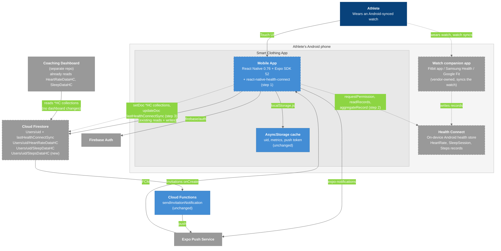
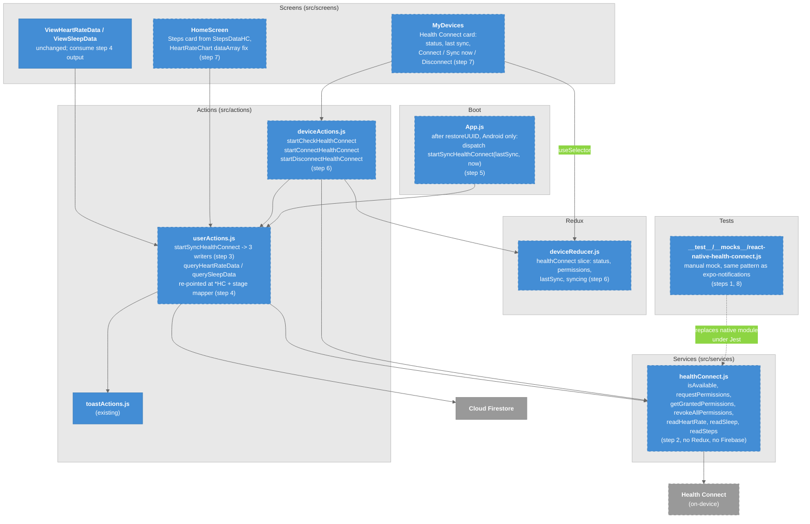
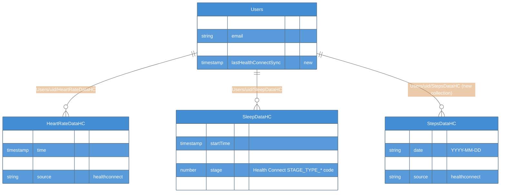

# T-001: Android: connect a smartwatch via Health Connect and show real heart rate, sleep, and steps

## Summary

Today the app cannot connect to any wearable. The **Devices** tab is a static list (`src/reducers/deviceReducer.js`), and every number on the **Home** dashboard is a hard-coded literal or random value (`src/screens/HomeScreen/index.jsx`, `src/actions/appActions.js:72`). The **Health** tab reads `Users/{uid}/HeartRateData` and `Users/{uid}/SleepData` from Firestore (`src/actions/userActions.js:866-929`), but nothing writes to those collections, and the Coaching Dashboard reads *different* collections (`HeartRateDataHC`, `SleepDataHC`).

This ticket adds the first real data source: **Google Health Connect** on Android. Any watch that syncs to the phone (Pixel Watch / Fitbit via the Fitbit app, Galaxy Watch via Samsung Health, Wear OS via Google Fit) writes heart rate, sleep sessions, and steps into Health Connect. The app reads from Health Connect, stores the data in Firestore in the shape the Coaching Dashboard already consumes, and the existing screens display it.

## Why

- One on-device integration covers every Android watch the athletes own. Samsung has no public cloud API for Galaxy Watch data, so on-device is the only option for those users.
- No backend, no OAuth client secret, no vendor rate limits, per-sample heart rate available.
- Requires the Android dev build (`npm run android`), which push notifications already require, so no new tooling.
- Deferred alternative: Fitbit Web API via Firebase Cloud Functions (server-side nightly sync, Fitbit/Pixel only, Blaze plan, intraday HR gated by Fitbit). The schema below includes a `source` field so that can be added later as a second source without UI changes.

## Architecture (target state, C4)

The diagrams show the app **after** this ticket; none of it exists on `main` yet. Dashed borders mark what this ticket adds. Step numbers refer to the Scope section below. Same colors as the vault's C4 set: dark blue = actor, light blue = things we build, gray = external / on-device platform.

### Level 2 - Container diagram (target state)



### Legend

- **Dark blue** = the athlete
- **Blue** = containers we build; **dashed** = changed or added by this ticket
- **Gray** = external systems; **dashed** = new to this ticket or gains new writes
- **Dashed arrow** = a data path this ticket creates
- **Light border** = boundary (the phone, the app)

What changes at this level: one new external (Health Connect, on the phone, not a cloud service), one new native dependency in the Mobile App, three `*HC` subcollections that the app now **writes** (today it only reads `HeartRateData` / `SleepData`, which nothing writes). Cloud Functions, Auth, Expo Push and the Coaching Dashboard are untouched.

### Level 3 - Component diagram (frontend, only the pieces this ticket adds or changes)



### Legend

- **Blue** = app modules; **dashed** = new or changed by this ticket
- **Gray** = external stores (Health Connect is dashed because it is new)
- **Dashed arrow** = the Jest mock standing in for the native module
- **Light border** = layer grouping

Layering rule the diagram encodes: **screens -> actions -> service -> Health Connect**. The service never imports Redux or Firebase; the reducer never touches the native module; only `userActions.js` talks to Firestore (matches the existing convention that nearly all Firebase access lives there).
### Level 4 - Firestore schema added by this ticket



### Legend

- **Entities** = Firestore documents; `PK` is the document id, chosen so re-syncs overwrite instead of duplicating
- **Relationship labels** = the subcollection path under `Users/uid`

`Users/{uid}/HeartRateData` and `Users/{uid}/SleepData` (the collections the app reads today) are not drawn: nothing writes them and after step 4 nothing reads them either. They become legacy and can be deleted in a follow-up.


## Scope

### 1. Dependency and native config
- Add `react-native-health-connect` (latest release compatible with Expo SDK 52 / RN 0.76). Follow its README for the Expo config plugin.

- `app.json`: add `android.permissions` `android.permission.health.READ_HEART_RATE`, `READ_SLEEP`, `READ_STEPS`; register the permissions-rationale activity the library requires. `minSdkVersion` must be >= 26.

- Run `npx expo prebuild --platform android` and confirm the `android/` diff is only the expected manifest/Gradle changes (the `customNamespacePlugin` still applies).

- Add a manual mock at `__test__/__mocks__/react-native-health-connect.js` (same pattern as `expo-notifications`) so Jest never loads the native module.

### 2. Health Connect service (`src/services/healthConnect.js`)
Thin wrapper around the library; no Redux, no Firebase:
- `isAvailable()` -> `getSdkStatus()` mapped to `"available" | "needs_update" | "unavailable"`.

- `requestPermissions()` -> `requestPermission([{accessType:"read", recordType:"HeartRate"|"SleepSession"|"Steps"}])`; returns the granted list.

- `getGrantedPermissions()`, `revokeAllPermissions()`.

- `readHeartRate(start, end)` -> flattens `record.samples[]` to `[{ time: Date, beatsPerMinute: number }]`.

- `readSleep(start, end)` -> flattens `record.stages[]` to `[{ startTime, endTime, stage: number }]` (keep the numeric Health Connect stage code).

- `readSteps(start, end)` -> `aggregateRecord({recordType:"Steps"})` per day -> `[{ date: "YYYY-MM-DD", count: number }]`.

### 3. Firestore writers (`src/actions/userActions.js`)
Follow the existing `start...`  convention. Write the shapes the Coaching Dashboard already reads (`coaching-dashboard/server/server.js`), plus `source`:

| Collection | Doc shape | Doc id (idempotent) |
|---|---|---|
| `Users/{uid}/HeartRateDataHC` | `{ time: Timestamp, beatsPerMinute: number, source: "healthconnect" }` | `hc_${time.toISOString()}` |
| `Users/{uid}/SleepDataHC` | `{ startTime: Timestamp, endTime: Timestamp, stage: number, source }` | `hc_${startTime.toISOString()}` |
| `Users/{uid}/StepsDataHC` *(new)* | `{ date: "YYYY-MM-DD", count: number, source }` | `hc_${date}` |

Use `setDoc` with deterministic ids so re-syncing a range never duplicates. Add `startSyncHealthConnect(startDate, endDate)` that calls the three readers and three writers and sets `lastHealthConnectSync: Timestamp` on `Users/{uid}`.

### 4. Point the app's readers at the same collections
- `queryHeartRateData` -> `HeartRateDataHC`, filter on `time`, return `{ date: time, heartRate: beatsPerMinute }` so `ViewHeartRateData` and `HeartRateChart` need no change.

- `querySleepData` -> `SleepDataHC`, filter on `startTime`, map `stage` to the labels `ViewSleepData` already parses: `STAGE_TYPE_DEEP -> "Deep"`, `LIGHT -> "Core"`, `REM -> "Rem"`, `AWAKE / AWAKE_IN_BED -> "Awake"`, `SLEEPING / UNKNOWN -> "In Bed"`; return `{ startDate, endDate, sleepValue }`.

- Update [[Firestore_Schema]] once merged (the `HeartRateData` / `SleepData` collections become legacy).

### 5. Incremental sync on app open
In `App.js`, after `restoreUUID` resolves and only when `Platform.OS === "android"` and permissions are granted: read `lastHealthConnectSync` (default 30 days ago) and call `startSyncHealthConnect(lastSync, now)`. Never block the UI on it; failures log and toast via the existing `toast` reducer.

### 6. Redux (`src/reducers/deviceReducer.js`)
Replace the dummy list with:
```js
{
  healthConnect: {
    status: "unknown" | "unavailable" | "needs_update" | "not_connected" | "connected",
    permissions: [],
    lastSync: null,
    syncing: false,
  }
}
```
Action types in `src/actions/types.js`; thunks `startCheckHealthConnect`, `startConnectHealthConnect`, `startDisconnectHealthConnect` in `src/actions/deviceActions.js` (delete the duplicate push-token helpers there).

### 7. UI
- **Devices tab** (`src/screens/MyDevices/index.jsx`): one card "Health Connect" showing status, last-sync time, and a Connect / Sync now / Disconnect button. Keep `DeviceCard` styling. Move the Sensoria/Hexoskin dummy cards under a "Coming soon" header or delete them (lead's call).

- **Home** (`src/screens/HomeScreen/index.jsx`): Steps card <- today's `StepsDataHC` doc; fix the `HeartRateChart` prop bug (`data=` -> `dataArray=`) and feed it today's heart rate. Show "No data - connect a device" when empty.

- **Health tab**: no changes beyond step 4. Verify both screens render the synced range.

### 8. Tests
- Unit: stage-code mapper, sample flattening, writer thunks (mock `firebaseConfig.js` per [[Testing]]), reducer.

- Integration: `MyDevices` renders each status; `HomeScreen` shows real steps from a mocked store.

- `npm test` stays green.

## Out of scope
- iOS / Apple HealthKit.

- Breath Rate and Ventilation charts (Hexoskin-only metrics; separate ticket).

- Background sync while the app is closed.

- Fitbit Web API / Cloud Functions sync (future second `source`).

- Coaching Dashboard changes (it already reads these collections; confirm the extra `source` field is ignored).

- Firestore rules hardening (separate ticket, see [[Firestore_Rules]]).

## Acceptance criteria
- [ ] On a physical Android phone with the Fitbit / Samsung Health / Google Fit app synced, tapping **Connect** on the Devices tab opens the Health Connect permission sheet; granting shows status "Connected" and a last-sync time.
- [ ] Firestore shows new docs under `HeartRateDataHC`, `SleepDataHC`, `StepsDataHC` with `source: "healthconnect"`; re-syncing does not create duplicates.
- [ ] The Coaching Dashboard's athlete view shows the same heart-rate and sleep data without dashboard code changes.
- [ ] Home dashboard Steps card shows today's real count; heart-rate chart is no longer a flat line.
- [ ] `ViewHeartRateData` and `ViewSleepData` display the synced range.
- [ ] On a device without Health Connect, the Devices card shows "Unavailable" and nothing crashes.
- [ ] `npm test` passes; the new mock lives in `__test__/__mocks__/`.
